<p align="center">
  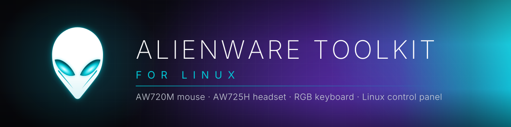
</p>

<h1 align="center">Alienware Toolkit for Linux: AW720M mouse RGB, AW725H headset fix, K617 keyboard preview<br><sub>An open-source Alienware Command Center (AWCC) alternative for Ubuntu / GNOME</sub></h1>

<p align="center">
  
  
  
  
  
  
  <a href="LICENSE"></a>
</p>

<p align="center">
  <b>🇺🇸 English</b> · <a href="#-português">🇧🇷 Português</a>
</p>

<p align="center">
  <a href="docs/media/tour.mp4">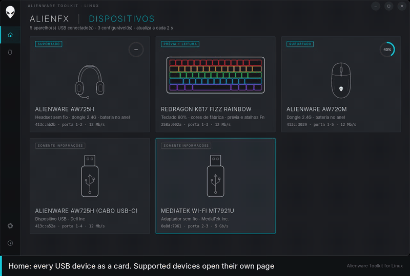</a><br>
  <sub>11-second highlight of a ~50-second tour recorded with the app's own demo mode (<a href="docs/media/tour.mp4">full MP4</a>). Nothing was sent to the devices during the recording.</sub>
</p>

**Alienware Toolkit for Linux** is a GTK4 / libadwaita control panel in the style of the Alienware Command Center (AWCC), which only exists for Windows. It lets you change the **RGB lighting of the Alienware AW720M wireless mouse**, see its **battery**, keep the **Alienware AW725H wireless headset from disconnecting every ~2.5 minutes**, read the headset battery, tune its microphone and a software **equalizer**, and preview the lighting of a **Redragon K617 Fizz Rainbow** 60% keyboard. Every device has a rotating **3D model** (three.js inside WebKit) that previews colors and effects live, before anything is sent.

> The interface is in **Brazilian Portuguese** (labels such as *APLICAR* = Apply, *CANCELAR* = Cancel, *ATUALIZAR* = Refresh). This README translates every label it mentions. An English UI is on the [roadmap](#roadmap).

## Table of contents

- [Features](#features)
- [Screenshots and videos](#screenshots-and-videos)
- [Installation](#installation)
- [Desktop icon & dock (animated on hover)](#desktop-icon--dock-animated-on-hover)
- [Usage, device by device](#usage-device-by-device)
- [How it works](#how-it-works)
- [AW725H headset disconnect fix](#aw725h-headset-disconnect-fix)
- [Keyboard: Redragon K617 Fizz Rainbow](#keyboard-redragon-k617-fizz-rainbow)
- [Security and permissions](#security-and-permissions)
- [Troubleshooting and FAQ](#troubleshooting-and-faq)
- [Roadmap](#roadmap)
- [Development](#development)
- [Credits](#credits)
- [License](#license)
- [Disclaimer](#disclaimer)
- [🇧🇷 Português](#-português)

## Features

Legend: ✅ works · 🧪 experimental / partial · 👁️ preview only (nothing is sent) · ❌ not possible today

### Alienware AW720M wireless mouse (`413c:3029` dongle, `413c:3028` USB-C cable)

| Feature | Status | Notes |
|---|---|---|
| Color, effect, brightness | ✅ | APIv7 protocol from [alienfx-tools](https://github.com/T-Troll/alienfx-tools), confirmed on the AW720M through the 2.4 GHz dongle. Effects: static, breathing, morph (2 colors), spectrum, pulse, rainbow. Brightness 0–100. |
| Zones | 🧪 | Zone 0, zone 1 or both (default). The AW720M has one RGB zone (the alien logo on the palm); which protocol zone maps to it is not confirmed yet, so "both" is the safe choice. |
| "Vivid colors" | ✅ | Host-side gamma 2.2 correction, so pastel colors do not look washed out on the LED (e.g. `#C061CB` is sent as `#891E9A`). On by default. |
| Live 3D preview | 👁️ | Color, effect and brightness show up on the 3D model instantly. Nothing goes to the mouse until **APLICAR** (Apply). |
| Battery level | 🧪 | Read from the power notice the mouse sends on its own (`c0 0a …`) when the magnetic charger is attached or removed. The panel shows the last notice; asking for the battery on demand is not known yet. |
| Charging state | 🧪 | Same notice (charger attached = charging). |
| DPI, polling rate, lift-off distance, power saving | ❌ | Needs a USB capture of AWCC on Windows (see [docs/aw720m-mouse-hid-protocol.md](docs/aw720m-mouse-hid-protocol.md)). |
| Macros, button remapping, firmware update | ❌ | Out of scope (risky). Use AWCC on Windows. |

### Alienware AW725H wireless headset (`413c:ab2b` dongle)

| Feature | Status | Notes |
|---|---|---|
| Dongle status, firmware version, link to the Dell firmware page | ✅ | Read from sysfs. Warns when the dongle reports firmware 1.00. |
| Dongle reboot counter (last hour, last 24 h, bars per hour) | ✅ | Read from the kernel log (`journalctl -k`): each reboot shows up as `0e8d:0003`. |
| **Disconnect guard** (stops the ~150 s reboot loop) | ✅ | User service `alienware-headset-guard.service` from [`aw725h-headset-disconnect-fix/`](aw725h-headset-disconnect-fix/). On/off switch in the app. |
| "Sound on one side only?" repair | ✅ | **TESTAR CANAIS (E/D)** (test left/right) and **REPARAR SOM AGORA** (repair sound now) buttons. |
| Default output/input, volume, mute | ✅ | PipeWire (`wpctl`). |
| Microphone gain, hardware headphone volume, mute | ✅ | Mixer of the dongle itself (`amixer -c Dongle`). |
| Hear your own voice (monitor) | 🧪 | Software loopback (`pw-loopback`), ~40–80 ms delay: the dongle exposes no hardware sidetone on Linux. |
| Equalizer | ✅ | Software EQ in PipeWire: virtual sink "AW725H EQ", 5 presets (Flat, Bass+, FPS footsteps, Voice, Custom) and 10 bands of ±12 dB. Works together with the guard. |
| Battery level | ✅ | **One** value (the headset has one internal battery for both ear cups), read passively from the dongle's own notices (report 8, `c0 09`, subtype 02). "Charging" is inferred when the value goes up. |
| RGB light of the alien heads | 👁️ | Preview only, on both ear cups in 3D. The protocol is unknown: it needs a USB capture of AWCC on Windows ([plan](docs/usbpcap-capture-plan-pt.md)). |
| EQ / sidetone / sleep timer inside the headset | ❌ | AWCC does not offer these for the AW725H (they belong to the Alienware Pro Wireless). |

### Redragon K617 Fizz Rainbow keyboard (K617-R-B, `258a:002a`)

| Feature | Status | Notes |
|---|---|---|
| 3D preview of the 60% / 61-key layout, black body, factory colors per row | 👁️ | Red, orange, green, blue and purple rows, as on the "-R" (Rainbow) models. |
| Preview of what the Fn keys do (mode, 5 brightness levels, 5 speed levels) | 👁️ | Breathing, pulse, rainbow wave, spectrum, off. |
| Fn shortcut table (from the K617 manual), keys light up in 3D | ✅ | Marks which combinations may not exist on the Rainbow revision. |
| Read the feature reports (GET_FEATURE), backup, compare readings | 🧪 | Only with the **optional** udev rule (`./install.sh --keyboard-experimental`); see [privacy](#security-and-permissions). |
| Changing colors, effects or brightness from Linux | ❌ | On the Rainbow revision the LED colors are fixed at the factory, and no reliable write protocol exists for `258a:002a`. If you own the **K617 RGB** (`258a:0049`), use [fizz-rgb](https://github.com/MrSchrodingers/fizz-rgb). |

### Any other USB device

| Feature | Status | Notes |
|---|---|---|
| Information card (vendor, product, ID, speed, port, interfaces and drivers) | ✅ | Read-only page ("Somente informações" = information only). |

## Screenshots and videos

All images were captured on a real Ubuntu 24.04 / GNOME 46 (Wayland) desktop by the app's demo mode, at 1280×800. The layout is the same on every device page:

1. **Sidebar** (left): logo, *Início* (Home), *Dispositivo* (last device opened), and at the bottom *Configurações* (Settings) and *Sobre* (About).
2. **Title** in thin capitals, `MODEL │ TYPE`, with a back arrow to Home; below it, a status line (battery, connection, firmware).
3. **3D viewer**: drag to rotate, mouse wheel to zoom, double click to reset. Two small buttons in its corner: **auto-rotate** on/off and **reset view**. Clicking a light zone (logo, alien head, key) jumps to the matching control.
4. **Tabs panel** (right) with the settings.
5. **Bottom bar**: status dot (cyan = OK, orange = problem) and the action buttons: **✕ CANCELAR / ✓ APLICAR** (Cancel / Apply) when there is something to send, **↻ ATUALIZAR** (Refresh, read-only) on the headset.

### Videos

| Mouse: colors and effects in 3D | Keyboard: Fn preview and shortcuts | Headset: tabs |
|---|---|---|
| [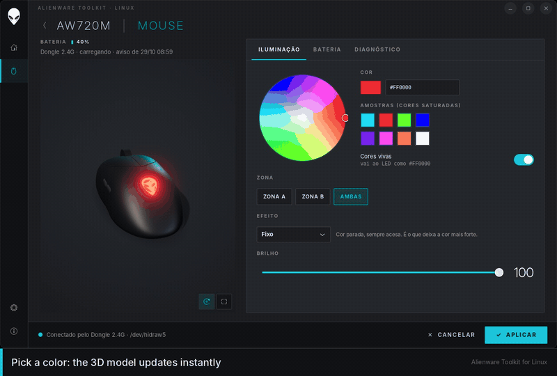](docs/media/mouse-3d-cores.mp4) | [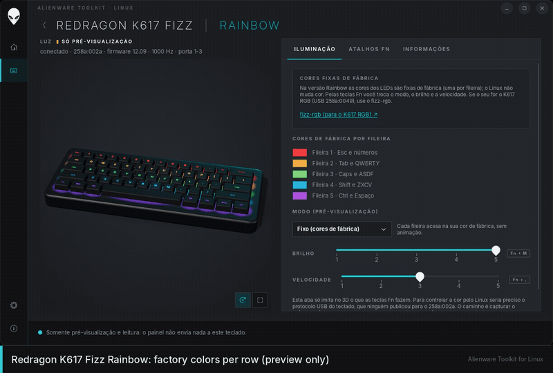](docs/media/teclado.mp4) | [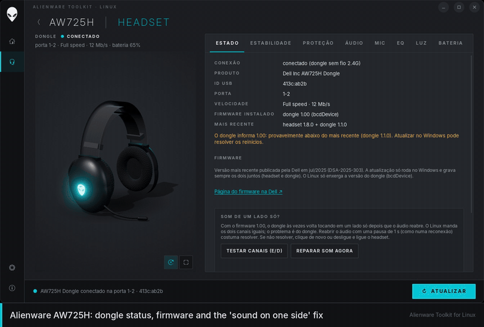](docs/media/headset.mp4) |
| Picking colors and effects updates the 3D model instantly; nothing is sent until APPLY. [MP4](docs/media/mouse-3d-cores.mp4) | Factory row colors, breathing and rainbow wave, then the Fn table lighting the keys. [MP4](docs/media/teclado.mp4) | Status, reboots, guard, EQ, light preview and battery. [MP4](docs/media/headset.mp4) |

### Home

<p align="center">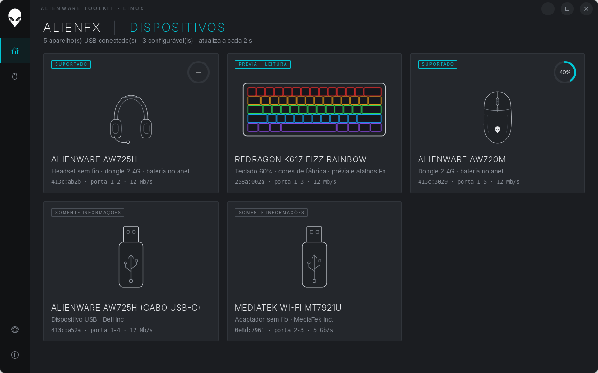</p>

*ALIENFX │ DISPOSITIVOS* (devices): one card per USB device, refreshed every 2 s, supported devices first. The **SUPORTADO** (supported) tag opens a full page; **PRÉVIA + LEITURA** (preview + read) is the keyboard; **SOMENTE INFORMAÇÕES** (information only) opens a read-only page. The rings show the last battery value of the mouse and of the headset (`—` = not reported yet). The headset plugged in by its USB-C cable (`413c:a52a`, charging) is listed separately from its dongle.

### Mouse AW720M

<table>
<tr>
<td width="50%">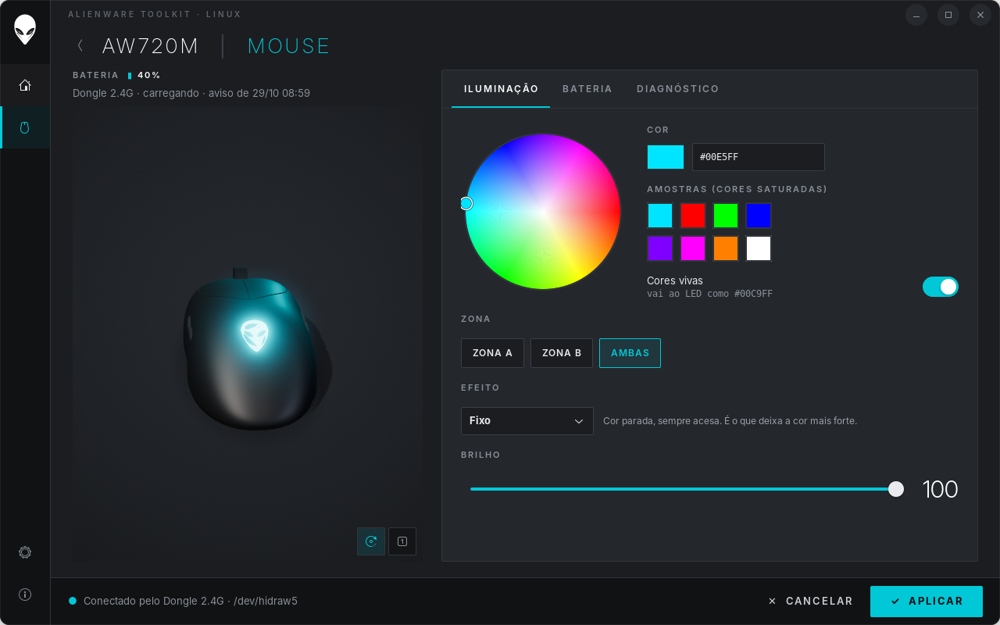</td>
<td width="50%">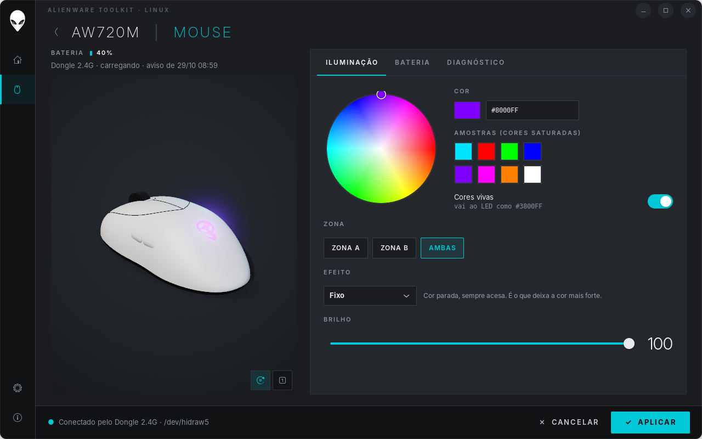</td>
</tr>
<tr>
<td><b>Iluminação</b> (lighting): color wheel (angle = hue, distance from the center = saturation), hex field, 8 saturated swatches, <i>Cores vivas</i> (vivid colors) switch with the value that really goes to the LED, zones (A, B, both), effect with a short explanation, and brightness 0–100. The 3D logo follows every change.</td>
<td>The same page with the body color set to <b>Lunar Light</b> (white). The body color of each device is chosen in Settings (Dark Side of the Moon black, Lunar Light white or a custom color) and only affects the 3D.</td>
</tr>
<tr>
<td>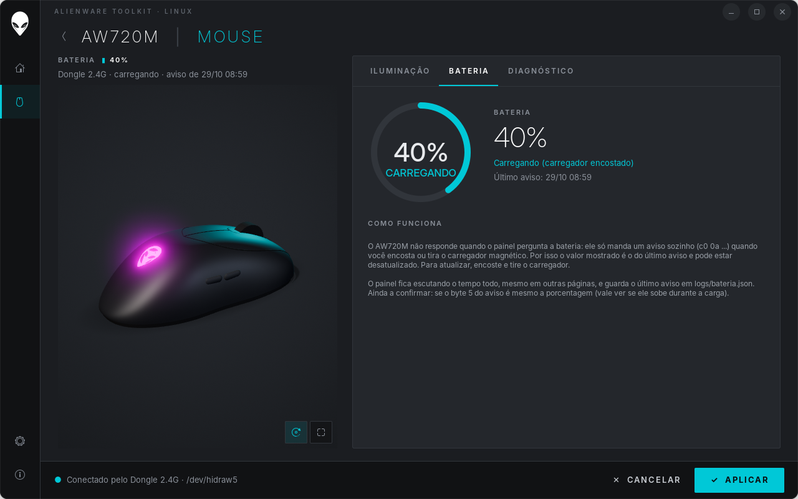</td>
<td>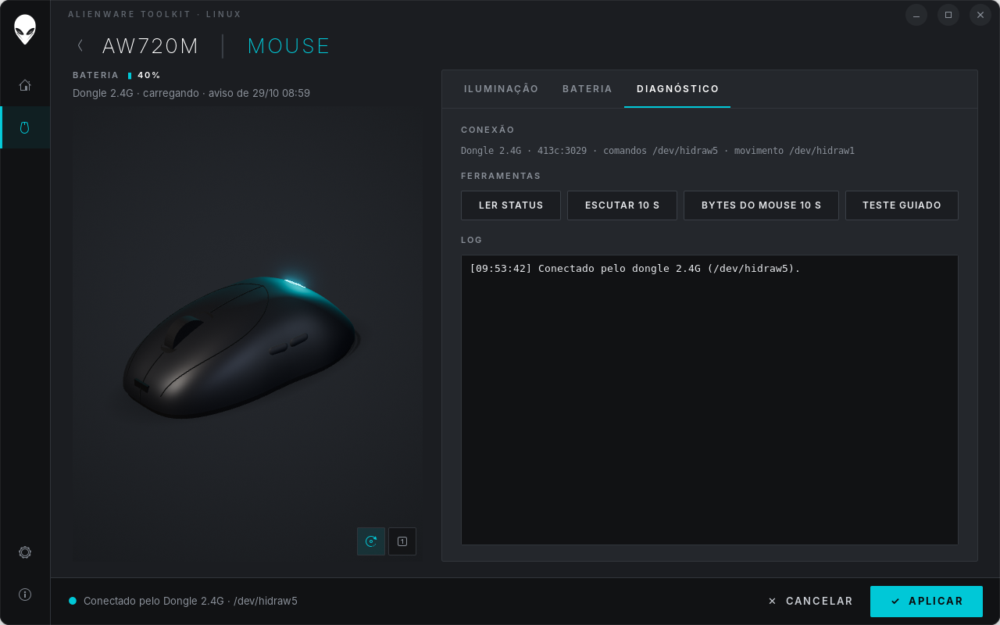</td>
</tr>
<tr>
<td><b>Bateria</b> (battery): ring with the last level, charging state, time of the last notice and the raw frame (<code>c0 0a …</code>), with an explanation of why the value only updates when the charger is attached or removed.</td>
<td><b>Diagnóstico</b> (diagnostics): connection details (command and motion hidraw nodes), protocol tools (<i>Ler status</i> read status, <i>Escutar 10 s</i> listen, <i>Bytes do mouse 10 s</i> motion bytes, <i>Teste guiado</i> guided test in a terminal) and a log saved in <code>logs/</code>.</td>
</tr>
</table>

### Keyboard Redragon K617 Fizz Rainbow

<table>
<tr>
<td width="50%">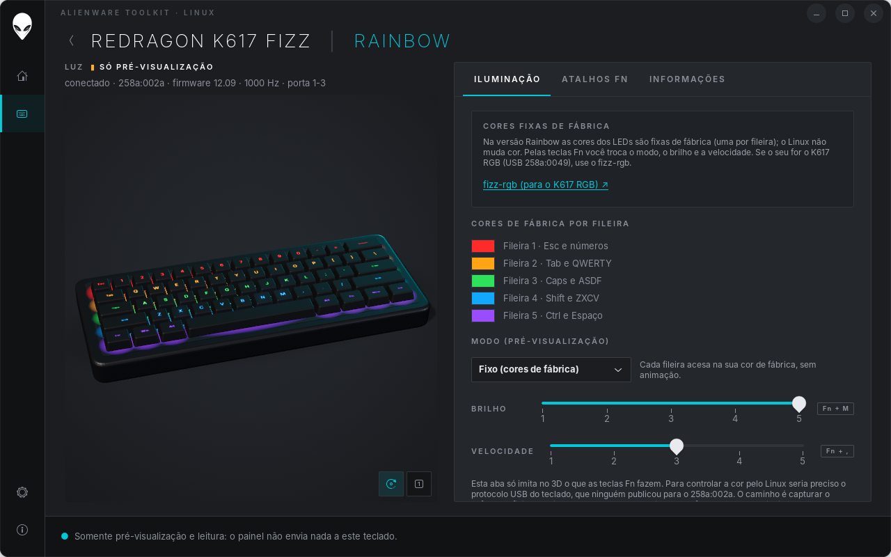</td>
<td width="50%">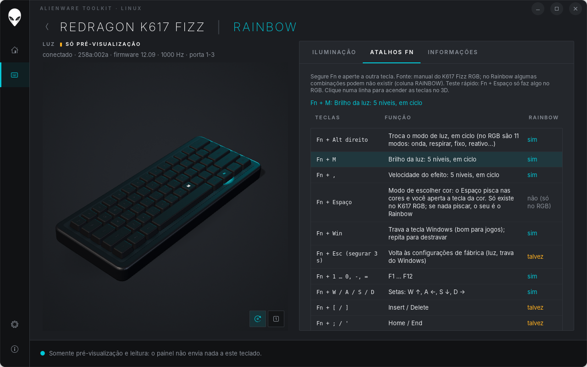</td>
</tr>
<tr>
<td><b>Iluminação</b> (lighting): an honest note that the Rainbow colors are fixed at the factory, with a link to fizz-rgb for the RGB revision; the five row colors; a <i>Modo</i> (mode) preview, and 5-level <i>Brilho</i> (brightness) and <i>Velocidade</i> (speed) sliders labeled with the real shortcuts (<kbd>Fn</kbd>+<kbd>M</kbd>, <kbd>Fn</kbd>+<kbd>,</kbd>). There is no Apply button on this page.</td>
<td><b>Atalhos Fn</b> (Fn shortcuts): every combination from the K617 manual, with a <i>RAINBOW</i> column (yes / maybe / no). Clicking a row lights those keys in 3D; clicking a key in 3D shows what it does with <kbd>Fn</kbd>.</td>
</tr>
<tr>
<td>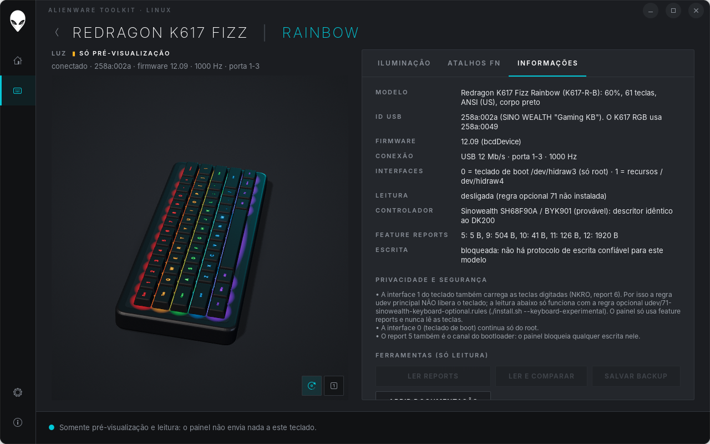</td>
<td></td>
</tr>
<tr>
<td><b>Informações</b> (information): model, USB IDs, firmware, polling rate, interfaces, feature reports, privacy and safety notes, and read-only tools (read reports, read and compare, backup, open the protocol document).</td>
<td></td>
</tr>
</table>

### Headset AW725H

<table>
<tr>
<td width="50%">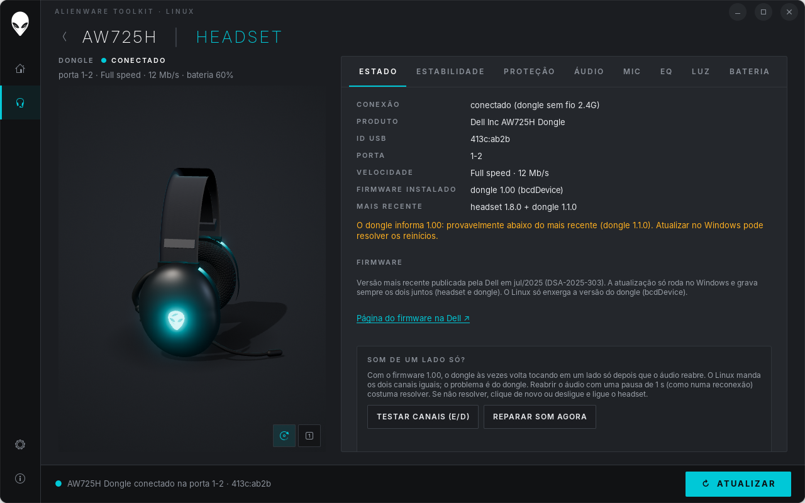</td>
<td width="50%">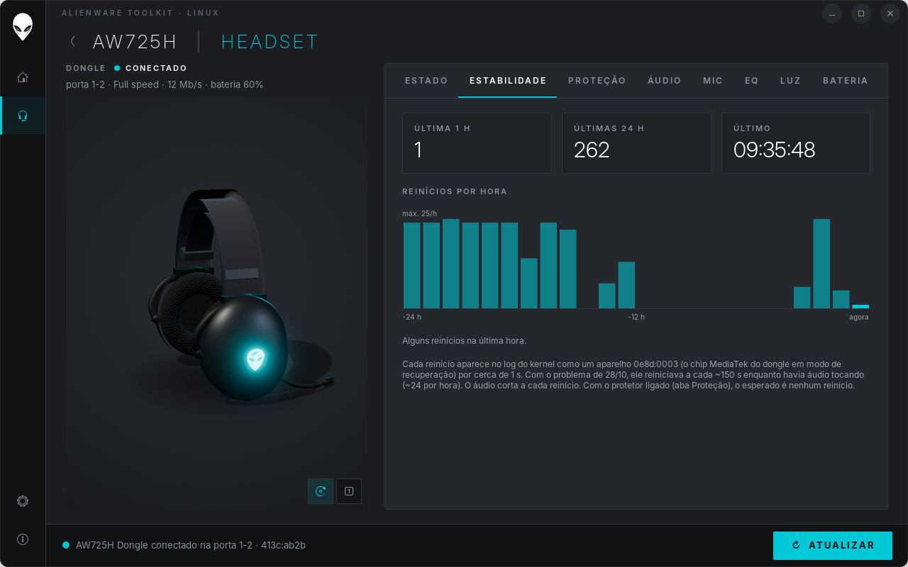</td>
</tr>
<tr>
<td><b>Estado</b> (status): connection, product, USB ID, port, speed, installed and latest firmware, a link to Dell's firmware page, the <b>"Som de um lado só?"</b> (sound on one side only?) box with <i>TESTAR CANAIS (E/D)</i> and <i>REPARAR SOM AGORA</i>, and <i>ABRIR GUIA</i> (open the fix guide).</td>
<td><b>Estabilidade</b> (stability): dongle reboots in the last hour, in the last 24 h, the last one, and a bar per hour. Here the guard was turned on in the morning and the reboots stopped.</td>
</tr>
<tr>
<td>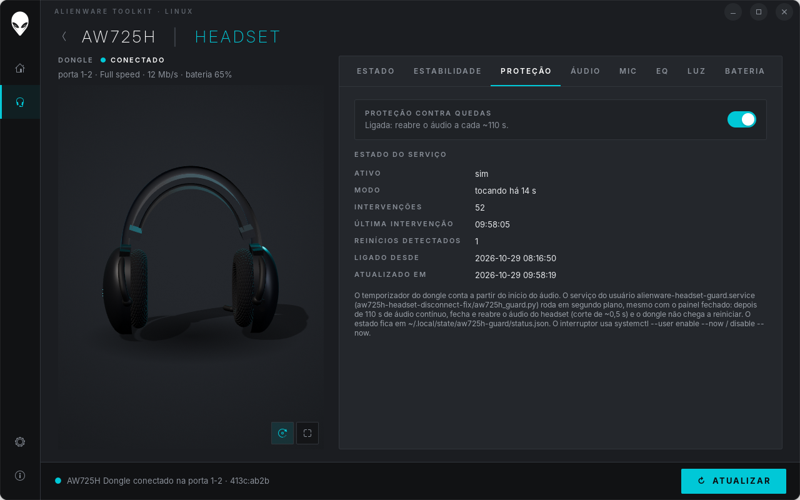</td>
<td>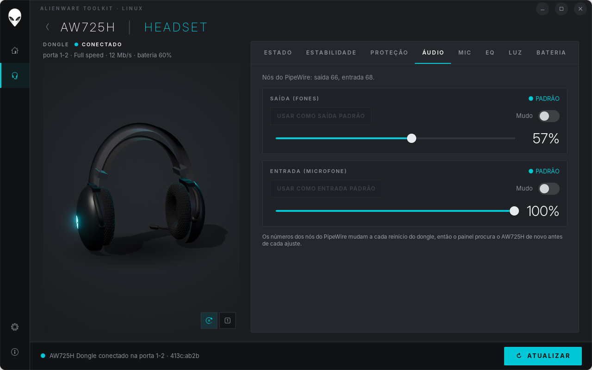</td>
</tr>
<tr>
<td><b>Proteção</b> (guard): on/off switch of <code>alienware-headset-guard.service</code> and its live state (active, mode, interventions, last one, reboots detected).</td>
<td><b>Áudio</b>: make the headset the default output/input, volume and mute through PipeWire (<code>wpctl</code>).</td>
</tr>
<tr>
<td>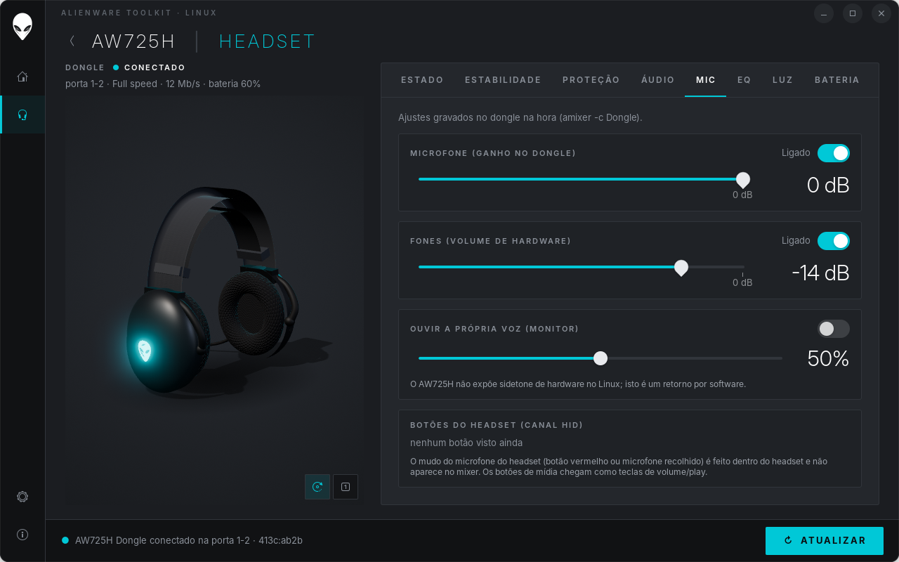</td>
<td>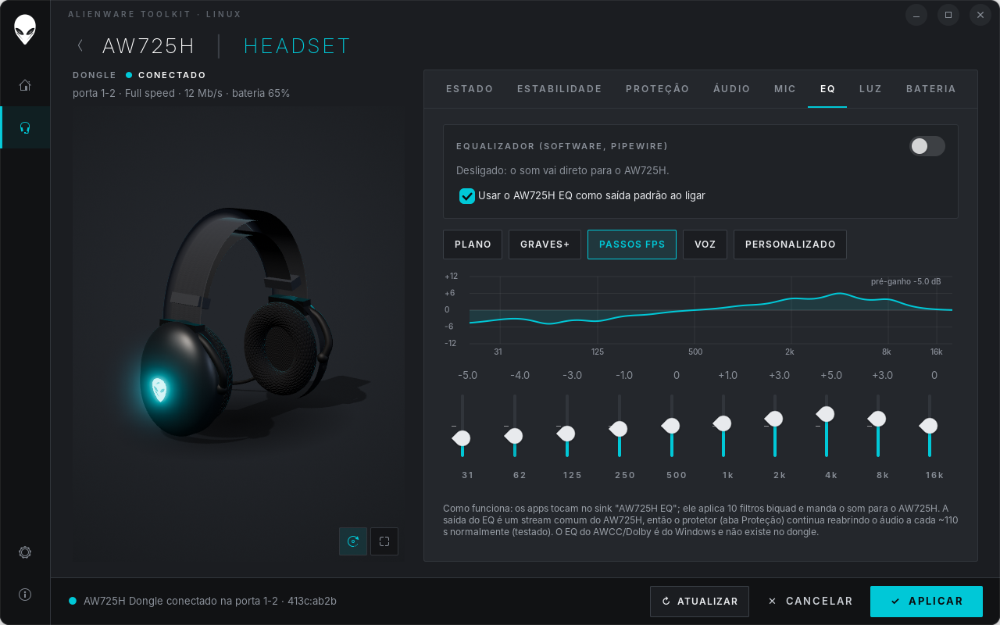</td>
</tr>
<tr>
<td><b>Mic</b>: microphone gain and hardware headphone volume stored in the dongle (<code>amixer -c Dongle</code>), the <i>own voice</i> monitor and the last headset button seen on the HID channel.</td>
<td><b>EQ</b>: switch for the "AW725H EQ" sink, presets, the response curve and 10 bands. On this tab the bottom bar shows <b>↻ ATUALIZAR + ✕ CANCELAR + ✓ APLICAR</b>.</td>
</tr>
<tr>
<td>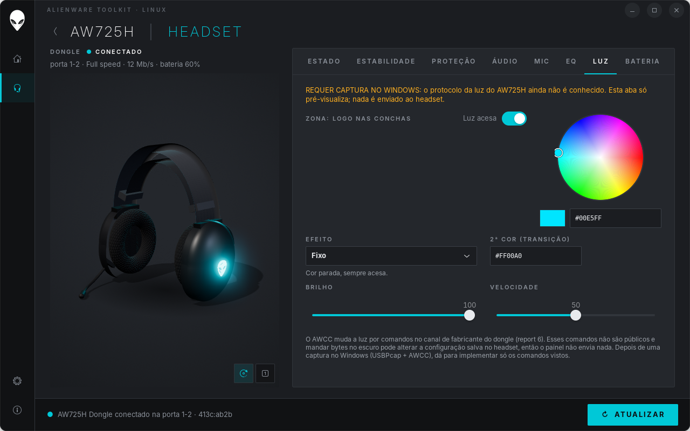</td>
<td>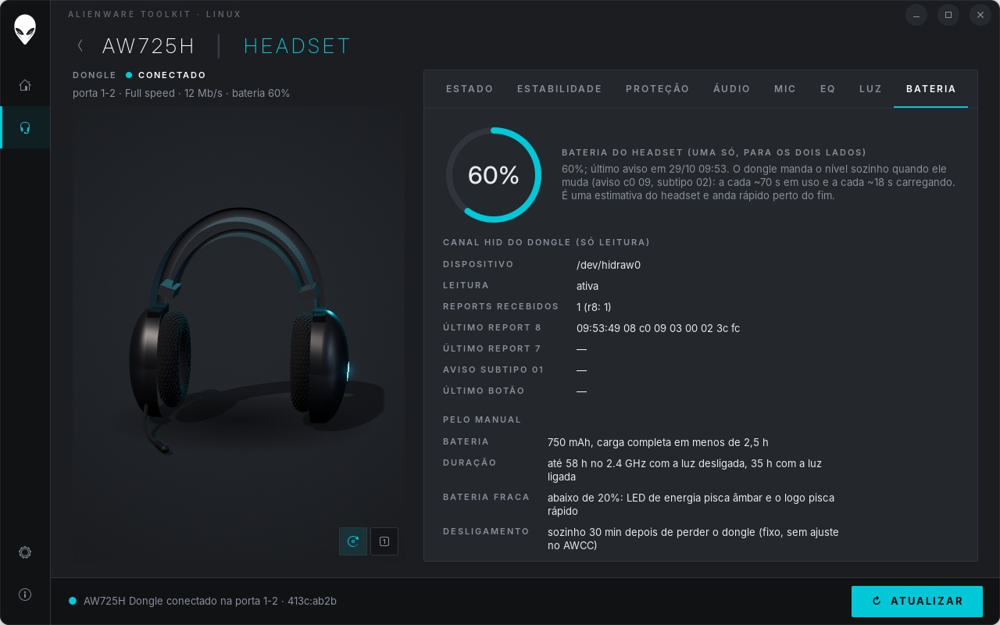</td>
</tr>
<tr>
<td><b>Luz</b> (light): preview of the alien-head logos (both ear cups) with color, effect, brightness and speed. A warning says it needs a Windows capture to really change the light.</td>
<td><b>Bateria</b> (battery): <b>one</b> value for both sides, the last notice, the passive HID reader state and the specs from the manual.</td>
</tr>
</table>

### Settings and About

<table>
<tr>
<td width="50%">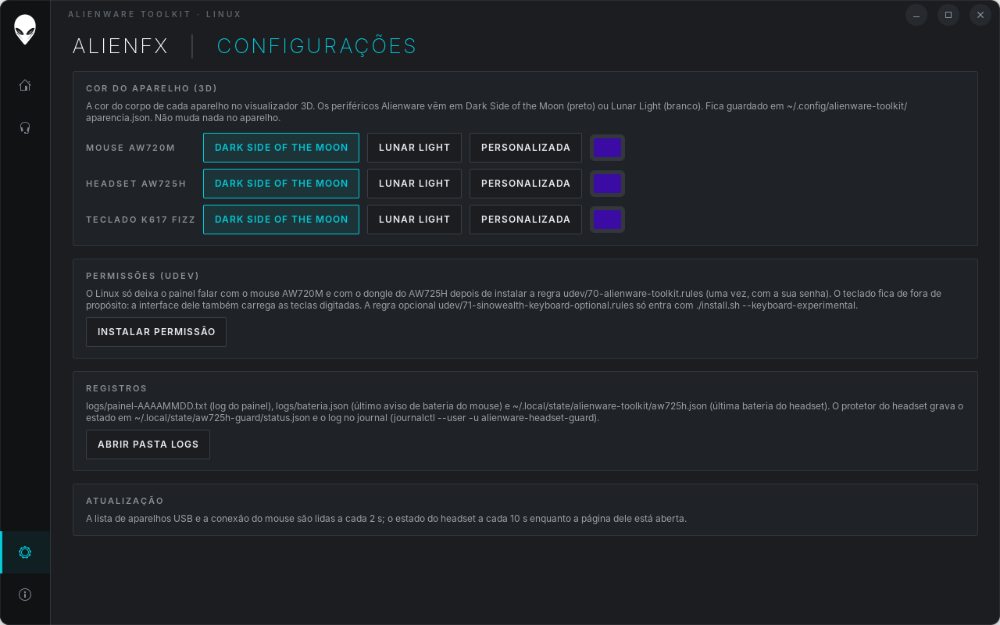</td>
<td width="50%">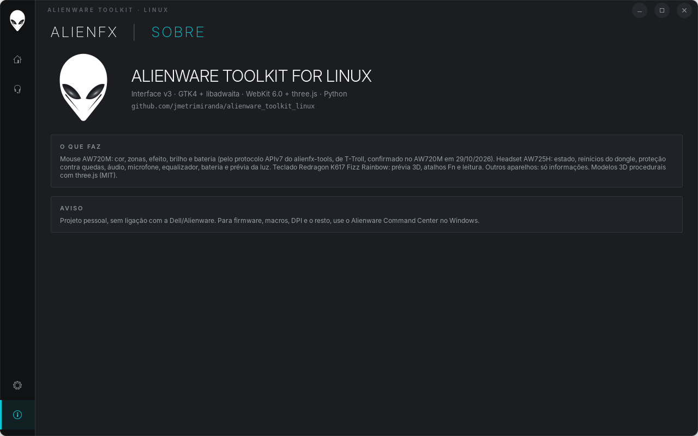</td>
</tr>
<tr>
<td><b>Configurações</b> (settings): <i>Cor do aparelho (3D)</i> per device (black, white, custom color picker), <i>Permissões (udev)</i> with <i>INSTALAR PERMISSÃO</i> (install permission), <i>Registros</i> (logs) and refresh intervals.</td>
<td><b>Sobre</b> (about): version, what the app does and the non-affiliation notice.</td>
</tr>
</table>

## Installation

Tested on **Ubuntu 24.04.5 LTS, GNOME 46 (Wayland), Python 3.12, GTK 4.14, libadwaita 1.5, WebKitGTK 6.0**. Other distributions with GTK ≥ 4.12, libadwaita and WebKitGTK 6.0 should work, but the installer and the dock extension target Ubuntu/GNOME 46.

1. **System packages** (GTK, libadwaita, WebKit for the 3D viewer, audio tools):
   ```bash
   sudo apt install git python3-venv python3-gi python3-gi-cairo gir1.2-gtk-4.0 gir1.2-adw-1 \
        gir1.2-rsvg-2.0 gir1.2-webkit-6.0 pulseaudio-utils alsa-utils
   ```
   Without `gir1.2-webkit-6.0` the app still works and shows SVG drawings instead of the 3D models.
2. **Get the code:**
   ```bash
   git clone https://github.com/jmetrimiranda/alienware_toolkit_linux.git
   cd alienware_toolkit_linux
   ```
3. **Run the installer as your normal user (do NOT use `sudo`)**; it asks for your password only to copy the udev rule:
   ```bash
   ./install.sh                  # .venv + udev rule (mouse and headset) + icon, launcher, dock and extension
   ```
   Options (can be combined):

   | Option | What it does |
   |---|---|
   | `--headset-fix` | Also installs the AW725H disconnect guard (user service) and the ModemManager rule. Recommended if you own the AW725H with dongle firmware 1.00. |
   | `--keyboard-experimental` | Also installs the **optional** keyboard rule `udev/71-sinowealth-keyboard-optional.rules` (asks you to type `yes`; read the [privacy note](#security-and-permissions) first). |
   | `--no-desktop` | Skips the icon, launcher, dock favorite and GNOME extension. |
   | `--no-udev` | Skips the udev rule (no sudo at all). The app opens, but cannot talk to the mouse or read the headset battery. |
   | `--uninstall` | Removes the launcher, extension, udev rules, guard and `.venv`. Your settings stay in `~/.config/alienware-toolkit`. |

   What it does, step by step: checks GTK 4 / libadwaita / WebKit 6.0 → creates `.venv` with `--system-site-packages` (uses Ubuntu's PyGObject) and installs `requirements.txt` → installs `udev/70-alienware-toolkit.rules` → (optional) installs the headset guard → runs `desktop/install-desktop.sh`.
4. **Open it** from the app menu (*Alienware Toolkit*) or run:
   ```bash
   ./alienware-command-center-linux/run.sh
   ```
5. If you installed the desktop part on Wayland, **log out and log back in once** so GNOME Shell loads the dock extension.

## Desktop icon & dock (animated on hover)

<p align="center">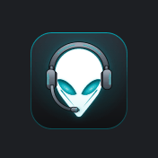</p>

The app ships its own icon (an original alien head wearing a headset with a boom microphone) and a small GNOME Shell extension that animates it when the mouse is over it in the **Ubuntu Dock** or in the **overview dash**: the eyes light up in cyan, the microphone LED blinks, the alien sways and hops. Leaving the icon restores it. The application ID is `io.github.jmetrimiranda.AlienwareToolkit`, so the open window is grouped with its dock icon.

Requirements: Ubuntu 24.04 / GNOME Shell 46 (Wayland or Xorg), Ubuntu Dock (default on Ubuntu). No root needed. `./install.sh` already does this; to do it by hand:

1. Install the icon, the launcher, the dock favorite and the extension:
   ```bash
   cd desktop
   ./install-desktop.sh            # defaults to ../alienware-command-center-linux (the folder with run.sh)
   ```
   It copies the icons to `~/.local/share/icons/hicolor/`, installs `~/.local/share/applications/io.github.jmetrimiranda.AlienwareToolkit.desktop` (with the real path in `Exec=`), pins it to the dock (`org.gnome.shell favorite-apps`, no duplicates) and installs the extension in `~/.local/share/gnome-shell/extensions/alienware-toolkit-hover@jmetrimiranda.github.io`.
2. **Log out and log back in once** (on Wayland, GNOME Shell only loads new extensions at login).
3. Hover the icon in the dock.

Check / troubleshoot:
```bash
gnome-extensions info alienware-toolkit-hover@jmetrimiranda.github.io   # State: ACTIVE
journalctl --user -b -g alienware-toolkit-hover                          # "ícone encontrado: dock (monitor 0)"
```
If the state is not ACTIVE, turn on user extensions in the *Extensions* app. Remove everything with `./install-desktop.sh --uninstall`.

## Usage, device by device

### AW720M mouse

1. Open the **AW720M** card on Home (or the mouse icon in the sidebar).
2. In **Iluminação**, pick a color (wheel, hex field or swatch), the zone, the effect and the brightness. The 3D model shows the result immediately.
3. Click **✓ APLICAR** (Apply) to send it to the mouse. **✕ CANCELAR** (Cancel) puts the controls back to the last applied setting without sending anything.
4. For the strongest color: saturated color (swatch or edge of the wheel), *Fixo* (static) effect, brightness 100 and *Cores vivas* on. Breathing and pulse spend part of the time dark and look weaker.
5. Battery: attach or remove the magnetic charger once; the mouse then sends its power notice and the ring updates. The app keeps listening in the background, on any page.

If the bottom bar says *sem permissão* (no permission), click **Dar permissão** (grant permission) in the yellow banner, or *Configurações → INSTALAR PERMISSÃO*.

### AW725H headset

- **Estado**: check the dongle firmware. If you hear sound on one side only, click **TESTAR CANAIS (E/D)** (you should hear "Front Left" on the left and "Front Right" on the right), then **REPARAR SOM AGORA**.
- **Proteção**: turn the guard on if the headset keeps dropping (dongle firmware 1.00). It runs as a user service, even with the app closed.
- **Estabilidade**: confirm that the reboots stopped.
- **Áudio / Mic**: default device, volumes, mute, microphone gain and the own-voice monitor. Mixer changes are applied immediately.
- **EQ**: choose a preset or move the bands, then **✓ APLICAR**. The switch creates/removes the "AW725H EQ" sink.
- **Luz**: preview only.
- **Bateria**: the value arrives by itself when it changes (about every 70 s in use, ~18 s while charging).
- **↻ ATUALIZAR** (Refresh) re-reads the connection, the reboot count, the guard service and the audio; it never sends anything to the headset.

### Redragon K617 Fizz Rainbow keyboard

- **Iluminação**: choose a mode, brightness and speed to see in 3D what the Fn keys will do; then use the real keys on the keyboard (<kbd>Fn</kbd>+<kbd>Right Alt</kbd>, <kbd>Fn</kbd>+<kbd>M</kbd>, <kbd>Fn</kbd>+<kbd>,</kbd>).
- **Atalhos Fn**: the shortcut list; click a row to light the keys in 3D. Quick test: <kbd>Fn</kbd>+<kbd>Space</kbd> only does something on the RGB revision.
- **Informações**: with the optional rule, *LER REPORTS* → change the mode with the Fn keys → *LER E COMPARAR* shows which bytes changed. This is the safe way to help map the protocol without writing anything.

## How it works

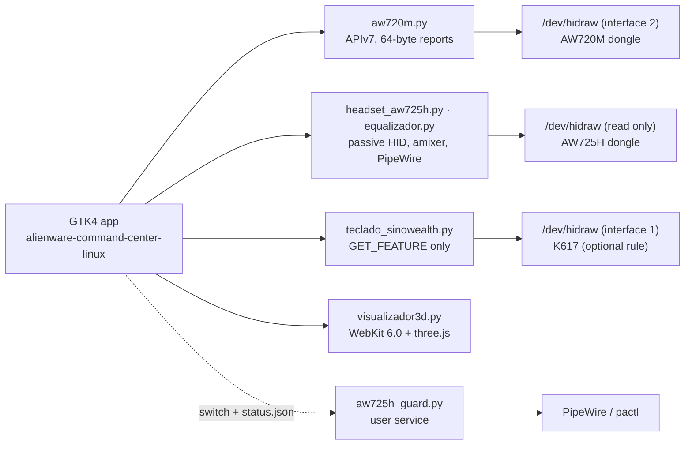

| Device | What the app talks to | Document |
|---|---|---|
| AW720M | Vendor interface 2 of the dongle (`0xFF00`, 64-byte reports without report ID). Commands from the **APIv7** protocol (alienfx-tools): set lighting `40 10 0c 00 EF BR ZN R G B R2 G2 B2`, status `40 03 01 00 01`; reply `40 <cmd> 03 00 ec ac` = OK. Power notice `c0 0a 09 00 01 <battery> <charger> …` sent by the mouse. | [docs/aw720m-mouse-hid-protocol.md](docs/aw720m-mouse-hid-protocol.md) |
| AW725H | sysfs (firmware), `journalctl -k` (reboots), `pactl`/`wpctl` (PipeWire), `amixer -c Dongle` (mixer), PipeWire filter-chain (EQ) and a **read-only** HID reader: report 8 `08 c0 09 03 00 <subtype> <value> <xor>` (subtype 02 = battery %). Nothing is ever written to the dongle's HID channel. | [docs/aw725h-headset-linux.md](docs/aw725h-headset-linux.md) |
| K617 Fizz Rainbow | Interface 1 feature reports 5 (5 B), 9 (504 B), 10 (41 B), 11 (126 B), 12 (1920 B), read with GET_FEATURE. Descriptors identical to the DK200 family (Sinowealth BYK901 / SH68F90A). Writes are blocked in code. | [docs/sinowealth-258a-002a-keyboard-protocol.md](docs/sinowealth-258a-002a-keyboard-protocol.md) |
| Unknown protocols | Plan to capture AWCC / the keyboard software on Windows with Wireshark + USBPcap, and read the `.pcapng` with `tools/ler_pcap_usbpcap.py`. | [docs/usbpcap-capture-plan-pt.md](docs/usbpcap-capture-plan-pt.md) |

The 3D viewer is a `WebKit.WebView` loading `assets/3d/visualizador.html` from disk (no internet): three.js 0.186.1 is vendored in `assets/vendor/three/` (MIT), the orbit controls and bloom are our own, and the three models are procedural (no free, downloadable model of these devices existed). Python calls `window.aw3d.*`; clicks on light zones come back as messages. If WebKit or WebGL is missing, the page shows the SVG drawing instead.

### Repository layout

```
alienware_toolkit_linux/
├── README.md                         this file
├── install.sh                        installer (venv, udev, guard, desktop) — run without sudo
├── requirements.txt                  pip extras for the tools (the app uses system GTK)
├── alienware-command-center-linux/   the GTK4 app
│   ├── app.py, run.sh, estilo.css, demo.py
│   ├── aw720m.py                     AW720M protocol (APIv7)
│   ├── headset_aw725h.py             AW725H passive HID reader, mixer, mic monitor
│   ├── equalizador.py                PipeWire EQ for the AW725H
│   ├── teclado_sinowealth.py         K617 / 258a:002a read-only module (writes blocked)
│   ├── k617_atalhos.py               Fn shortcut table
│   ├── aparencia.py                  device body colors (~/.config/alienware-toolkit/aparencia.json)
│   ├── dispositivos.py               USB list, reboots, guard service, PipeWire
│   ├── ui/                           pages, widgets, 3D viewer, headset extra tabs
│   └── assets/                       logo, SVGs, 3D page and models, vendored three.js
├── aw725h-headset-disconnect-fix/    standalone fix for the AW725H dongle reboot loop
├── tools/                            command-line probes (sondar.py, sondar_teclado.py, …)
├── udev/                             70-alienware-toolkit.rules, 71-…-optional.rules, installer
├── desktop/                          icons, .desktop, GNOME Shell extension, install-desktop.sh
└── docs/                             protocol notes, development notes, media/
```

## AW725H headset disconnect fix

**Symptom:** the Alienware AW725H wireless headset drops every ~2.5 minutes on Linux while audio is playing; the kernel log shows a device `0e8d:0003` appearing for a second (the MediaTek chip of the dongle rebooting).

**Cause:** with **dongle firmware 1.00**, the dongle (`413c:ab2b`) reboots about **140–150 s after the audio stream starts** (not after the USB connection). In our logs: 288 reboots in one day, 286 of them with audio playing.

**Workaround (this repo):** the guard `aw725h_guard.py` runs as the user service `alienware-headset-guard.service`. After **110 s** of continuous playback it fully closes and reopens the headset PCM: it moves the streams to a null sink, suspends the headset sink for 0.3 s and moves them back (a ~0.5 s gap), so the dongle's timer never reaches the limit. A short pause without really closing the PCM (16 ms) was tried and left sound on one side only, so the PCM is really closed. State file: `~/.local/state/aw725h-guard/status.json`.

**Permanent fix:** update, on Windows, to **headset firmware 1.8.0 + dongle firmware 1.1.0** (Dell, July 2025, DSA-2025-303); the updater always writes both together. Then check with the guard off: 0 reboots in 30 min of audio (`tools/monitor_headset.sh 30`).

Install only the fix: `./install.sh --headset-fix`, or see the full guide in [`aw725h-headset-disconnect-fix/`](aw725h-headset-disconnect-fix/) (it also works without the app).

## Keyboard: Redragon K617 Fizz Rainbow

The keyboard tested here is a **Redragon K617 Fizz Rainbow, model K617-R-B**: 60%, 61 keys, US ANSI, black body, USB ID `258a:002a` (reported as SINO WEALTH "Gaming KB").

- **Colors are fixed at the factory.** On the Rainbow ("-R") revision each row has its own LED color (red, orange, green, blue, purple). The Fn keys only change the mode (<kbd>Fn</kbd>+<kbd>Right Alt</kbd>), brightness (<kbd>Fn</kbd>+<kbd>M</kbd>, 5 levels) and speed (<kbd>Fn</kbd>+<kbd>,</kbd>, 5 levels). Linux cannot change the colors, and this app does not promise it.
- **K617 RGB is a different device.** The K617 Fizz **RGB** uses `258a:0049` and already has third-party Linux control: [fizz-rgb](https://github.com/MrSchrodingers/fizz-rgb) by MrSchrodingers (MIT, `fizzctl` on PyPI). It does not support the Rainbow `258a:002a`, which has a different descriptor (report 9 of 504 bytes, report 12 of 1920 bytes).
- **No reliable write protocol.** The same PID is reused by several brands with different firmware; OpenRGB disabled generic Sinowealth keyboards after its code bricked Redragon keyboards; and **report 5 is also the bootloader (ISP) channel**. The module refuses every write.
- **What is missing for real control (mode/brightness/speed from Linux):** a USB capture of the official Redragon software on Windows (Wireshark + USBPcap), changing one thing at a time. Plan in [docs/sinowealth-258a-002a-keyboard-protocol.md](docs/sinowealth-258a-002a-keyboard-protocol.md). **Contributions are welcome**, especially captures, or read/compare dumps made with *LER E COMPARAR* (read and compare) while you press the Fn keys.

Fn shortcuts (from the K617 Fizz RGB manual; some may not exist on the Rainbow):

| Keys | Function | On the Rainbow |
|---|---|---|
| <kbd>Fn</kbd>+<kbd>Right Alt</kbd> | Next lighting mode | yes |
| <kbd>Fn</kbd>+<kbd>M</kbd> | Brightness, 5 levels | yes |
| <kbd>Fn</kbd>+<kbd>,</kbd> | Effect speed, 5 levels | yes |
| <kbd>Fn</kbd>+<kbd>Space</kbd> | Color pick mode (RGB only: if nothing blinks, yours is the Rainbow) | no |
| <kbd>Fn</kbd>+<kbd>Win</kbd> | Lock / unlock the Windows key | yes |
| <kbd>Fn</kbd>+<kbd>Esc</kbd> (hold 3 s) | Factory reset (lighting, Win lock) | maybe |
| <kbd>Fn</kbd>+<kbd>1</kbd> … <kbd>0</kbd>, <kbd>-</kbd>, <kbd>=</kbd> | F1 … F12 | yes |
| <kbd>Fn</kbd>+<kbd>W</kbd> <kbd>A</kbd> <kbd>S</kbd> <kbd>D</kbd> | Arrow keys | yes |
| <kbd>Fn</kbd>+<kbd>[</kbd> / <kbd>]</kbd> | Insert / Delete | maybe |
| <kbd>Fn</kbd>+<kbd>;</kbd> / <kbd>'</kbd> | Home / End | maybe |
| <kbd>Fn</kbd>+<kbd>.</kbd> / <kbd>/</kbd> | Page Up / Page Down | maybe |

## Security and permissions

- **udev, not root.** `/dev/hidraw*` is `root 0600` on Ubuntu. `udev/70-alienware-toolkit.rules` adds `TAG+="uaccess"` only for the AW720M (`413c:3028`, `413c:3029`) and the AW725H dongle (`413c:ab2b`), so the logged-in user can open them. The number 70 matters: `uaccess` must be tagged before `73-seat-late.rules`.
- **The keyboard is not in the main rule on purpose.** Interface 0 of the K617 is the boot keyboard and is **never** opened up. Interface 1 holds the lighting feature reports, **but it also carries your keystrokes (NKRO, report 6)**: with access to it, any program in your session could read what you type. That is why `udev/71-sinowealth-keyboard-optional.rules` is opt-in (`./install.sh --keyboard-experimental`, with a confirmation) and only needed for the read-only tools. The app itself only uses feature reports and never reads keystrokes. Remove the rule when you are done: `sudo rm /etc/udev/rules.d/71-sinowealth-keyboard-optional.rules && sudo udevadm control --reload-rules`.
- **Report 5 of the keyboard is the bootloader channel**: writing `05 75 …` would reboot it into firmware-flashing mode. `teclado_sinowealth.py` blocks any write to it, and all keyboard writes are disabled anyway.
- **Nothing is sent without a click.** The mouse only receives a command on **✓ APLICAR** (or the diagnostic *Ler status* button). Previews (colors, effects, Fn modes, headset light) only touch the 3D model. The headset's HID channel is opened read-only.
- **Demo and capture modes send nothing** and do not write settings: they only move preview controls.
- **Only commands that were seen working are implemented.** No random command scanning (it could change settings stored in the device). No firmware flashing.
- The installer refuses to run as root; it calls `sudo` itself only to copy the udev rule (and the optional ModemManager rule of the headset fix).

## Troubleshooting and FAQ

<details>
<summary><b>Sound on one side only (AW725H)</b></summary>

With dongle firmware 1.00, the dongle sometimes comes back playing on **one side only** after the audio stream reopens. Linux sends both channels equally; the problem is in the dongle.

- In the app: **Headset → Estado → "Som de um lado só?"**: click **TESTAR CANAIS (E/D)** (you should hear "Front Left" on the left and "Front Right" on the right), then **REPARAR SOM AGORA** (repair sound now) to reopen the stream with a 1 s pause, like a reconnection.
- From a terminal:
  ```bash
  python3 aw725h-headset-disconnect-fix/aw725h_guard.py --channel-test   # left/right voice test
  python3 aw725h-headset-disconnect-fix/aw725h_guard.py --reopen 1.0     # reopen the stream (1 s pause)
  ```
- If it does not fix it, click again, or turn the headset off and on.
</details>

<details>
<summary><b>Why is there only one battery value for the headset?</b></summary>

The AW725H has **one internal battery** that powers both ear cups, so there is no per-side battery. The value comes from a notice the dongle sends on its own when the level changes (report 8, `c0 09`, subtype 02), read without sending anything. Until the first notice arrives, the app says "não informado pelo dongle" (not reported by the dongle yet). It looks like an estimate and moves quickly near the end.
</details>

<details>
<summary><b>The mouse page says "sem permissão" (no permission)</b></summary>

The udev rule is missing or the device was plugged before it was installed. Run `./install.sh` again (or click *Dar permissão*), then unplug and replug the dongle. Check with `getfacl /dev/hidrawN` (your user must appear).
</details>

<details>
<summary><b>The 3D model does not appear (I see a drawing instead)</b></summary>

Install `gir1.2-webkit-6.0`. Without WebKit 6.0, or if WebGL fails, the page falls back to the SVG drawing and prints the reason in the terminal (`./alienware-command-center-linux/run.sh`). Set `AW3D_DEPURAR=1` to enable the WebKit inspector.
</details>

<details>
<summary><b>The mouse battery shows "—" or an old value</b></summary>

The AW720M does not answer battery requests (as far as we know); it only sends a power notice when the magnetic charger is attached or removed. Attach/remove it once. The last value is saved in `logs/bateria.json`.
</details>

<details>
<summary><b>The dock icon does not animate</b></summary>

On Wayland, log out and back in once after installing. Then check `gnome-extensions info alienware-toolkit-hover@jmetrimiranda.github.io` (State: ACTIVE) and turn on user extensions in the *Extensions* app if needed.
</details>

<details>
<summary><b>"No Bluetooth found" / can I use the mouse over Bluetooth?</b></summary>

The AW720M also has Bluetooth, but this app talks to it through the 2.4 GHz dongle (or the USB-C cable). Bluetooth would give only the standard battery service, not lighting. On the test PC the Wi-Fi card (MT7921U) has no Bluetooth interface at all.
</details>

<details>
<summary><b>The mouse turns off when I plug the USB-C cable into it (413c:3028)</b></summary>

`97-hid2hci.rules` from bluez may switch it off (bluez issue #2680). Copy `/usr/lib/udev/rules.d/97-hid2hci.rules` to `/etc/udev/rules.d/` and add `ATTRS{product}!="*AW720M*"` to the Dell line.
</details>

<details>
<summary><b>Does this replace Alienware Command Center?</b></summary>

No, only the parts listed in [Features](#features). Firmware updates, DPI, macros and the headset light still need AWCC on Windows.
</details>

## Roadmap

- [ ] English UI (the code and labels are in Portuguese today).
- [ ] AW720M: on-demand battery, DPI, polling rate and lift-off distance (needs a USBPcap capture of AWCC).
- [ ] AW725H: real control of the alien-head light (needs a capture); decode the second HID notice (subtype 01).
- [ ] K617 Fizz Rainbow: mode/brightness/speed from Linux if a safe protocol is captured.
- [ ] Publish the batteries to UPower so they appear in the GNOME power menu.
- [ ] Low-battery notification.
- [ ] Packaging (Flatpak or .deb).

## Development

- **Run from the source:** `./alienware-command-center-linux/run.sh` (uses `../.venv` if it exists, otherwise `python3`).
- **Screenshot mode** (no screen needed with broadway):
  ```bash
  ALIENWARE_CAPTURA=/tmp/out.png ALIENWARE_PAGINA=mouse:bateria ./alienware-command-center-linux/run.sh
  ```
  `ALIENWARE_PAGINA` = `inicio`, `mouse[:iluminacao|bateria|diagnostico]`, `headset[:estado|estabilidade|protecao|audio|microfone|equalizador|iluminacao|bateria]`, `teclado[:iluminacao|atalhos|informacoes]`, `config`, `sobre` or `outro`. `ALIENWARE_ESPERA` = seconds before the capture (default 2.5). `ALIENWARE_SEM_3D=1` forces the SVG drawings (automatic under `GDK_BACKEND=broadway`).
- **Demo mode** (used for the GIFs and videos in this README; needs a real screen for WebGL):
  ```bash
  ALIENWARE_DEMO=tour  ALIENWARE_DEMO_PASTA=/tmp/demo  ./alienware-command-center-linux/run.sh   # JPEG frames + quadros.jsonl captions
  ALIENWARE_DEMO=fotos ALIENWARE_DEMO_PASTA=/tmp/fotos ./alienware-command-center-linux/run.sh   # one PNG per page and tab
  ```
  It navigates by itself, records frames on the frame clock's `after-paint` (`ALIENWARE_DEMO_FPS`, default 10) and quits (`ALIENWARE_DEMO_LIMITE`, default 62 s). It only moves preview controls.
- **Tools** (`tools/`, all read-only unless marked):

  | Tool | Purpose |
  |---|---|
  | `sondar.py escutar 60` / `extras 20` / `gravar 90` / `guiado` | Listen to the AW720M (safe); logs go to the app's `logs/`. `status` and `cor` are experimental and send commands. |
  | `teste_guiado.sh` | Opens the guided mouse test in a terminal. |
  | `monitor_headset.sh 30` | Counts AW725H dongle reboots in the last N minutes. |
  | `sondar_teclado.py info` / `ler` / `backup` / `comparar A B` | K617 / `258a:002a` feature reports (GET_FEATURE only). |
  | `escuta_passiva.py`, `analisar_escuta.py` | Long passive listen of the AW725H dongle and decoding of the log. |
  | `ler_pcap_usbpcap.py captura.pcapng` | Lists the HID control transfers of a Windows USBPcap capture. |
- **Notes:** the development notebook (in Portuguese) is in [docs/development-notes-pt.md](docs/development-notes-pt.md).

## Credits

- **[alienfx-tools](https://github.com/T-Troll/alienfx-tools) by T-Troll**: the APIv7 protocol used for the AW720M lighting (originally for the AW610M).
- **[three.js](https://threejs.org/)** (MIT): 3D rendering, vendored in `alienware-command-center-linux/assets/vendor/three/` with its license.
- **3D models:** procedural, made for this project (no free downloadable model of these devices was found). Search notes in [docs/3d-models-credits-pt.md](docs/3d-models-credits-pt.md).
- **[fizz-rgb](https://github.com/MrSchrodingers/fizz-rgb) by MrSchrodingers** (MIT): reference for owners of the K617 Fizz RGB (`258a:0049`).
- **OpenRGB** issue [#1804](https://gitlab.com/CalcProgrammer1/OpenRGB/-/issues/1804): identification of the DK200 / BYK901 Sinowealth family and its descriptors.
- Logo, icon and dock animation: original drawings for this project.

## License

Released under the [MIT License](LICENSE) © 2026 Jorge Metri Miranda. You can use, modify and redistribute it, including in other projects (OpenRGB, libratbag, etc.), as long as the copyright notice is kept. The vendored three.js keeps its own MIT license.

## Disclaimer

This is an independent, community project. It is **not affiliated with, endorsed by or sponsored by Dell, Alienware or Redragon**. Alienware, AlienFX, Alienware Command Center, Dark Side of the Moon and Lunar Light are trademarks of Dell Inc.; Redragon and K617 Fizz belong to their owners. The logo and icons are original drawings inspired by the brand. Use at your own risk: the app only sends commands that were seen working, but it comes with no warranty.

---

# 🇧🇷 Português

<p align="center"><a href="#table-of-contents">🇺🇸 English</a> · <b>🇧🇷 Português</b></p>

## Alienware Toolkit para Linux: RGB do mouse AW720M, conserto do headset AW725H e prévia do teclado K617

<p align="center">
  <a href="docs/media/tour.mp4"></a><br>
  <sub>Trecho de 11 s de um tour de ~50 s gravado pelo próprio modo de demonstração do app (<a href="docs/media/tour.mp4">MP4 completo</a>). Nada foi enviado aos aparelhos durante a gravação.</sub>
</p>

O **Alienware Toolkit para Linux** é um painel GTK4 / libadwaita no estilo do Alienware Command Center (AWCC), que só existe para Windows. Com ele dá para mudar a **iluminação RGB do mouse sem fio Alienware AW720M**, ver a **bateria** dele, impedir que o **headset sem fio Alienware AW725H caia a cada ~2,5 minutos**, ler a bateria do headset, ajustar o microfone e um **equalizador** por software, e pré-visualizar a luz do teclado 60% **Redragon K617 Fizz Rainbow**. Cada aparelho tem um **modelo 3D** giratório (three.js dentro do WebKit) que mostra cores e efeitos na hora, antes de qualquer envio.

> A interface está em **português do Brasil**. Uma versão em inglês está no [roteiro](#roteiro).

### Índice

- [Recursos](#recursos)
- [Telas e vídeos](#telas-e-vídeos)
- [Instalação](#instalação)
- [Ícone na área de trabalho e na dock (animado ao passar o mouse)](#ícone-na-área-de-trabalho-e-na-dock-animado-ao-passar-o-mouse)
- [Uso, aparelho por aparelho](#uso-aparelho-por-aparelho)
- [Como funciona](#como-funciona)
- [Conserto das quedas do headset AW725H](#conserto-das-quedas-do-headset-aw725h)
- [Teclado: Redragon K617 Fizz Rainbow](#teclado-redragon-k617-fizz-rainbow)
- [Segurança e permissões](#segurança-e-permissões)
- [Problemas comuns e perguntas frequentes](#problemas-comuns-e-perguntas-frequentes)
- [Roteiro](#roteiro)
- [Desenvolvimento](#desenvolvimento)
- [Créditos](#créditos)
- [Licença](#licença)
- [Aviso](#aviso)

### Recursos

Legenda: ✅ funciona · 🧪 experimental / parcial · 👁️ só pré-visualização (nada é enviado) · ❌ não dá hoje

#### Mouse sem fio Alienware AW720M (`413c:3029` dongle, `413c:3028` cabo USB-C)

| Recurso | Situação | Observações |
|---|---|---|
| Cor, efeito, brilho | ✅ | Protocolo APIv7 do [alienfx-tools](https://github.com/T-Troll/alienfx-tools), confirmado no AW720M pelo dongle 2.4 GHz. Efeitos: fixo, respirar, transição (2 cores), espectro, pulsar, arco-íris. Brilho 0–100. |
| Zonas | 🧪 | Zona A (0), zona B (1) ou ambas (padrão). O AW720M tem uma zona RGB (o logo de alien na palma); ainda não está confirmado qual zona do protocolo é ela, por isso "ambas" é o mais seguro. |
| "Cores vivas" | ✅ | Correção de gama 2,2 no computador, para cores pastel não saírem esbranquiçadas no LED (ex.: `#C061CB` vai como `#891E9A`). Ligada por padrão. |
| Prévia 3D ao vivo | 👁️ | Cor, efeito e brilho aparecem no modelo 3D na hora. Nada vai ao mouse antes de **✓ APLICAR**. |
| Nível da bateria | 🧪 | Lido do aviso de energia que o mouse manda sozinho (`c0 0a …`) ao encostar ou tirar o carregador magnético. O painel mostra o último aviso; ainda não se sabe pedir a bateria na hora. |
| Carregando | 🧪 | Mesmo aviso (carregador encostado = carregando). |
| DPI, taxa de polling, distância de levantamento, economia de energia | ❌ | Precisa de uma captura USB do AWCC no Windows (ver [docs/aw720m-mouse-hid-protocol.md](docs/aw720m-mouse-hid-protocol.md)). |
| Macros, remapear botões, atualizar firmware | ❌ | Fora do escopo (arriscado). Use o AWCC no Windows. |

#### Headset sem fio Alienware AW725H (dongle `413c:ab2b`)

| Recurso | Situação | Observações |
|---|---|---|
| Estado do dongle, versão de firmware, link para a página de firmware da Dell | ✅ | Lido do sysfs. Avisa quando o dongle informa firmware 1.00. |
| Contagem de reinícios do dongle (última hora, 24 h, barras por hora) | ✅ | Lida do log do kernel (`journalctl -k`): cada reinício aparece como `0e8d:0003`. |
| **Protetor contra quedas** (acaba com o ciclo de reinício a cada ~150 s) | ✅ | Serviço do usuário `alienware-headset-guard.service`, de [`aw725h-headset-disconnect-fix/`](aw725h-headset-disconnect-fix/). Interruptor no app. |
| Reparo de "som de um lado só" | ✅ | Botões **TESTAR CANAIS (E/D)** e **REPARAR SOM AGORA**. |
| Saída/entrada padrão, volume, mudo | ✅ | PipeWire (`wpctl`). |
| Ganho do microfone, volume de hardware dos fones, mudo | ✅ | Mixer do próprio dongle (`amixer -c Dongle`). |
| Ouvir a própria voz (retorno) | 🧪 | Retorno por software (`pw-loopback`), atraso de ~40–80 ms: o dongle não oferece sidetone de hardware no Linux. |
| Equalizador | ✅ | EQ por software no PipeWire: sink virtual "AW725H EQ", 5 presets (Plano, Graves+, Passos FPS, Voz, Personalizado) e 10 bandas de ±12 dB. Funciona junto com o protetor. |
| Nível da bateria | ✅ | **Um** valor (o headset tem uma bateria interna para as duas conchas), lido sem enviar nada dos avisos do próprio dongle (report 8, `c0 09`, subtipo 02). "Carregando" é deduzido quando o valor sobe. |
| Luz RGB das cabeças de alien | 👁️ | Só prévia, nas duas conchas no 3D. O protocolo é desconhecido: precisa de captura USB do AWCC no Windows ([plano](docs/usbpcap-capture-plan-pt.md)). |
| EQ / sidetone / desligamento automático dentro do headset | ❌ | O AWCC não oferece isso para o AW725H (são do Alienware Pro Wireless). |

#### Teclado Redragon K617 Fizz Rainbow (K617-R-B, `258a:002a`)

| Recurso | Situação | Observações |
|---|---|---|
| Prévia 3D do layout 60% / 61 teclas, corpo preto, cores de fábrica por fileira | 👁️ | Fileiras vermelha, laranja, verde, azul e roxa, como nos modelos "-R" (Rainbow). |
| Prévia do que as teclas Fn fazem (modo, 5 níveis de brilho, 5 de velocidade) | 👁️ | Respirar, pulsar, onda arco-íris, espectro, apagado. |
| Tabela de atalhos Fn (do manual do K617), teclas acendem no 3D | ✅ | Marca as combinações que podem não existir no Rainbow. |
| Ler os feature reports (GET_FEATURE), backup, comparar leituras | 🧪 | Só com a regra udev **opcional** (`./install.sh --keyboard-experimental`); veja a [privacidade](#segurança-e-permissões). |
| Mudar cor, efeito ou brilho pelo Linux | ❌ | Na versão Rainbow as cores dos LEDs são fixas de fábrica, e não há protocolo de escrita confiável para o `258a:002a`. Se o seu for o **K617 RGB** (`258a:0049`), use o [fizz-rgb](https://github.com/MrSchrodingers/fizz-rgb). |

#### Qualquer outro aparelho USB

| Recurso | Situação | Observações |
|---|---|---|
| Cartão de informações (fabricante, produto, ID, velocidade, porta, interfaces e drivers) | ✅ | Página só de leitura ("Somente informações"). |

### Telas e vídeos

Todas as imagens foram capturadas num Ubuntu 24.04 / GNOME 46 (Wayland) de verdade, pelo modo de demonstração do app, em 1280×800. O desenho é o mesmo em todas as páginas de aparelho:

1. **Barra lateral** (esquerda): logo, *Início*, *Dispositivo* (o último aparelho aberto) e, embaixo, *Configurações* e *Sobre*.
2. **Título** em caixa alta fina, `MODELO │ TIPO`, com a seta de voltar ao Início; abaixo, uma linha de estado (bateria, conexão, firmware).
3. **Visualizador 3D**: arraste para girar, roda do mouse para o zoom, duplo clique para voltar. Dois botões discretos no canto: **girar sozinho** liga/desliga e **resetar vista**. Clicar numa zona de luz (logo, cabeça de alien, tecla) leva ao controle correspondente.
4. **Painel com abas** (direita), com os ajustes.
5. **Barra inferior**: bolinha de estado (ciano = ok, laranja = problema) e os botões: **✕ CANCELAR / ✓ APLICAR** quando há algo a enviar, **↻ ATUALIZAR** (só leitura) no headset.

#### Vídeos

| Mouse: cores e efeitos no 3D | Teclado: prévia das teclas Fn e atalhos | Headset: abas |
|---|---|---|
| [](docs/media/mouse-3d-cores.mp4) | [](docs/media/teclado.mp4) | [](docs/media/headset.mp4) |
| Escolher cores e efeitos muda o 3D na hora; nada é enviado antes de APLICAR. [MP4](docs/media/mouse-3d-cores.mp4) | Cores de fábrica por fileira, respirar e onda arco-íris, depois a tabela Fn acendendo as teclas. [MP4](docs/media/teclado.mp4) | Estado, reinícios, protetor, EQ, prévia da luz e bateria. [MP4](docs/media/headset.mp4) |

#### Início

<p align="center"></p>

*ALIENFX │ DISPOSITIVOS*: um cartão por aparelho USB, atualizado a cada 2 s, com os suportados primeiro. A etiqueta **SUPORTADO** abre uma página completa; **PRÉVIA + LEITURA** é o teclado; **SOMENTE INFORMAÇÕES** abre uma página só de leitura. Os anéis mostram a última bateria do mouse e do headset (`—` = ainda não informada). O headset ligado pelo cabo USB-C (`413c:a52a`, carregando) aparece separado do dongle.

#### Mouse AW720M

<table>
<tr>
<td width="50%"></td>
<td width="50%"></td>
</tr>
<tr>
<td><b>Iluminação</b>: roda de cores (ângulo = matiz, distância do centro = saturação), campo hexadecimal, 8 amostras saturadas, a chave <i>Cores vivas</i> com o valor que vai de fato ao LED, zonas (A, B, ambas), efeito com uma explicação curta e brilho 0–100. O logo no 3D acompanha cada mudança.</td>
<td>A mesma página com a cor do corpo em <b>Lunar Light</b> (branco). A cor do corpo de cada aparelho é escolhida em Configurações (Dark Side of the Moon preto, Lunar Light branco ou personalizada) e só vale para o 3D.</td>
</tr>
<tr>
<td></td>
<td></td>
</tr>
<tr>
<td><b>Bateria</b>: anel com o último nível, se está carregando, a hora do último aviso e o quadro bruto (<code>c0 0a …</code>), com a explicação de por que o valor só atualiza ao encostar ou tirar o carregador.</td>
<td><b>Diagnóstico</b>: detalhes da conexão (hidraw de comandos e de movimento), ferramentas do protocolo (<i>Ler status</i>, <i>Escutar 10 s</i>, <i>Bytes do mouse 10 s</i>, <i>Teste guiado</i> num terminal) e o log, salvo em <code>logs/</code>.</td>
</tr>
</table>

#### Teclado Redragon K617 Fizz Rainbow

<table>
<tr>
<td width="50%"></td>
<td width="50%"></td>
</tr>
<tr>
<td><b>Iluminação</b>: aviso honesto de que as cores do Rainbow são fixas de fábrica, com link para o fizz-rgb da versão RGB; as cinco cores das fileiras; a prévia de <i>Modo</i> e os controles de <i>Brilho</i> e <i>Velocidade</i> em 5 níveis, com os atalhos reais ao lado (<kbd>Fn</kbd>+<kbd>M</kbd>, <kbd>Fn</kbd>+<kbd>,</kbd>). Esta página não tem botão APLICAR.</td>
<td><b>Atalhos Fn</b>: todas as combinações do manual do K617, com a coluna <i>RAINBOW</i> (sim / talvez / não). Clicar numa linha acende essas teclas no 3D; clicar numa tecla do 3D mostra o que ela faz com <kbd>Fn</kbd>.</td>
</tr>
<tr>
<td></td>
<td></td>
</tr>
<tr>
<td><b>Informações</b>: modelo, IDs USB, firmware, taxa de polling, interfaces, feature reports, notas de privacidade e segurança e ferramentas só de leitura (ler reports, ler e comparar, backup, abrir a documentação do protocolo).</td>
<td></td>
</tr>
</table>

#### Headset AW725H

<table>
<tr>
<td width="50%"></td>
<td width="50%"></td>
</tr>
<tr>
<td><b>Estado</b>: conexão, produto, ID USB, porta, velocidade, firmware instalado e mais recente, link para a página de firmware da Dell, o quadro <b>"Som de um lado só?"</b> com <i>TESTAR CANAIS (E/D)</i> e <i>REPARAR SOM AGORA</i>, e <i>ABRIR GUIA</i> (guia do conserto).</td>
<td><b>Estabilidade</b>: reinícios do dongle na última hora, nas últimas 24 h, o último e uma barra por hora. Aqui o protetor foi ligado de manhã e os reinícios pararam.</td>
</tr>
<tr>
<td></td>
<td></td>
</tr>
<tr>
<td><b>Proteção</b>: interruptor do <code>alienware-headset-guard.service</code> e o estado dele ao vivo (ativo, modo, intervenções, última, reinícios detectados).</td>
<td><b>Áudio</b>: usar o headset como saída/entrada padrão, volume e mudo pelo PipeWire (<code>wpctl</code>).</td>
</tr>
<tr>
<td></td>
<td></td>
</tr>
<tr>
<td><b>Mic</b>: ganho do microfone e volume de hardware dos fones gravados no dongle (<code>amixer -c Dongle</code>), o retorno da <i>própria voz</i> e o último botão do headset visto no canal HID.</td>
<td><b>EQ</b>: chave do sink "AW725H EQ", presets, a curva de resposta e 10 bandas. Nesta aba a barra inferior mostra <b>↻ ATUALIZAR + ✕ CANCELAR + ✓ APLICAR</b>.</td>
</tr>
<tr>
<td></td>
<td></td>
</tr>
<tr>
<td><b>Luz</b>: prévia dos logos de cabeça de alien (as duas conchas) com cor, efeito, brilho e velocidade. Um aviso diz que mudar a luz de verdade requer captura no Windows.</td>
<td><b>Bateria</b>: <b>um</b> valor para os dois lados, o último aviso, o estado do leitor HID passivo e os dados do manual.</td>
</tr>
</table>

#### Configurações e Sobre

<table>
<tr>
<td width="50%"></td>
<td width="50%"></td>
</tr>
<tr>
<td><b>Configurações</b>: <i>Cor do aparelho (3D)</i> por aparelho (preto, branco, cor personalizada), <i>Permissões (udev)</i> com <i>INSTALAR PERMISSÃO</i>, <i>Registros</i> e os intervalos de atualização.</td>
<td><b>Sobre</b>: versão, o que o app faz e o aviso de que não há vínculo com a Dell.</td>
</tr>
</table>

### Instalação

Testado no **Ubuntu 24.04.5 LTS, GNOME 46 (Wayland), Python 3.12, GTK 4.14, libadwaita 1.5, WebKitGTK 6.0**. Outras distribuições com GTK ≥ 4.12, libadwaita e WebKitGTK 6.0 devem funcionar, mas o instalador e a extensão da dock são para Ubuntu/GNOME 46.

1. **Pacotes do sistema** (GTK, libadwaita, WebKit para o 3D, ferramentas de áudio):
   ```bash
   sudo apt install git python3-venv python3-gi python3-gi-cairo gir1.2-gtk-4.0 gir1.2-adw-1 \
        gir1.2-rsvg-2.0 gir1.2-webkit-6.0 pulseaudio-utils alsa-utils
   ```
   Sem o `gir1.2-webkit-6.0` o app funciona igual e mostra desenhos SVG no lugar dos modelos 3D.
2. **Baixe o código:**
   ```bash
   git clone https://github.com/jmetrimiranda/alienware_toolkit_linux.git
   cd alienware_toolkit_linux
   ```
3. **Rode o instalador como seu usuário (NÃO use `sudo`)**; ele pede a senha só para copiar a regra udev:
   ```bash
   ./install.sh                  # .venv + regra udev (mouse e headset) + ícone, atalho, dock e extensão
   ```
   Opções (podem ser combinadas):

   | Opção | O que faz |
   |---|---|
   | `--headset-fix` | Instala também o protetor do AW725H (serviço do usuário) e a regra do ModemManager. Recomendado para o AW725H com dongle no firmware 1.00. |
   | `--keyboard-experimental` | Instala também a regra **opcional** do teclado `udev/71-sinowealth-keyboard-optional.rules` (pede que você digite `sim`; leia antes a [nota de privacidade](#segurança-e-permissões)). |
   | `--no-desktop` | Não instala ícone, atalho, favorito da dock nem a extensão do GNOME. |
   | `--no-udev` | Não instala a regra udev (nada de sudo). O app abre, mas não fala com o mouse nem lê a bateria do headset. |
   | `--uninstall` | Remove atalho, extensão, regras udev, protetor e `.venv`. As suas configurações ficam em `~/.config/alienware-toolkit`. |

   O que ele faz, passo a passo: confere GTK 4 / libadwaita / WebKit 6.0 → cria o `.venv` com `--system-site-packages` (usa o PyGObject do Ubuntu) e instala o `requirements.txt` → instala `udev/70-alienware-toolkit.rules` → (opcional) instala o protetor do headset → roda o `desktop/install-desktop.sh`.
4. **Abra** pelo menu de aplicativos (*Alienware Toolkit*) ou rode:
   ```bash
   ./alienware-command-center-linux/run.sh
   ```
5. Se instalou a parte de desktop no Wayland, **saia e entre na sessão uma vez** para o GNOME Shell carregar a extensão da dock.

### Ícone na área de trabalho e na dock (animado ao passar o mouse)

<p align="center"></p>

O app tem ícone próprio (cabeça de alien original usando headset com microfone) e uma pequena extensão do GNOME Shell que o anima quando o mouse passa por cima dele na **Ubuntu Dock** ou no **dash do overview**: os olhos acendem em ciano, o LED do microfone pisca, o alien balança e dá um pulinho. Ao tirar o mouse, o ícone volta ao normal. O ID do aplicativo é `io.github.jmetrimiranda.AlienwareToolkit`, então a janela aberta fica agrupada com o ícone da dock.

Requisitos: Ubuntu 24.04 / GNOME Shell 46 (Wayland ou Xorg) com a Ubuntu Dock (padrão no Ubuntu). Não precisa de root. O `./install.sh` já faz isto; para fazer à mão:

1. Instale o ícone, o atalho, o favorito da dock e a extensão:
   ```bash
   cd desktop
   ./install-desktop.sh            # padrão: ../alienware-command-center-linux (a pasta com o run.sh)
   ```
   Ele copia os ícones para `~/.local/share/icons/hicolor/`, instala `~/.local/share/applications/io.github.jmetrimiranda.AlienwareToolkit.desktop` (com o caminho real no `Exec=`), fixa o app na dock (`org.gnome.shell favorite-apps`, sem duplicar) e instala a extensão em `~/.local/share/gnome-shell/extensions/alienware-toolkit-hover@jmetrimiranda.github.io`.
2. **Saia e entre na sessão uma vez** (no Wayland o GNOME Shell só carrega extensões novas no login).
3. Passe o mouse sobre o ícone na dock.

Conferir / resolver problemas:
```bash
gnome-extensions info alienware-toolkit-hover@jmetrimiranda.github.io   # State: ACTIVE
journalctl --user -b -g alienware-toolkit-hover                          # "ícone encontrado: dock (monitor 0)"
```
Se o estado não for ACTIVE, ligue as extensões de usuário no app *Extensões*. Para remover tudo: `./install-desktop.sh --uninstall`.

### Uso, aparelho por aparelho

#### Mouse AW720M

1. Abra o cartão **AW720M** no Início (ou o ícone do mouse na barra lateral).
2. Em **Iluminação**, escolha a cor (roda, campo hexadecimal ou amostra), a zona, o efeito e o brilho. O 3D mostra o resultado na hora.
3. Clique em **✓ APLICAR** para enviar ao mouse. **✕ CANCELAR** volta os controles à última configuração aplicada, sem enviar nada.
4. Para a cor mais forte: cor saturada (amostra ou borda da roda), efeito *Fixo*, brilho 100 e *Cores vivas* ligado. Respirar e pulsar passam parte do tempo apagados e parecem mais fracos.
5. Bateria: encoste ou tire o carregador magnético uma vez; o mouse manda o aviso de energia e o anel atualiza. O app escuta o tempo todo, em qualquer página.

Se a barra inferior disser *sem permissão*, clique em **Dar permissão** na faixa amarela, ou em *Configurações → INSTALAR PERMISSÃO*.

#### Headset AW725H

- **Estado**: confira o firmware do dongle. Se o som sair de um lado só, clique em **TESTAR CANAIS (E/D)** (você deve ouvir "Front Left" à esquerda e "Front Right" à direita) e depois em **REPARAR SOM AGORA**.
- **Proteção**: ligue o protetor se o headset vive caindo (dongle no firmware 1.00). Ele roda como serviço do usuário, mesmo com o app fechado.
- **Estabilidade**: confirme que os reinícios pararam.
- **Áudio / Mic**: aparelho padrão, volumes, mudo, ganho do microfone e o retorno da própria voz. As mudanças no mixer valem na hora.
- **EQ**: escolha um preset ou mexa nas bandas e clique em **✓ APLICAR**. A chave cria/remove o sink "AW725H EQ".
- **Luz**: só prévia.
- **Bateria**: o valor chega sozinho quando muda (a cada ~70 s em uso, ~18 s carregando).
- **↻ ATUALIZAR** relê a conexão, os reinícios, o serviço do protetor e o áudio; nunca envia nada ao headset.

#### Teclado Redragon K617 Fizz Rainbow

- **Iluminação**: escolha modo, brilho e velocidade para ver no 3D o que as teclas Fn vão fazer; depois use as teclas de verdade no teclado (<kbd>Fn</kbd>+<kbd>Alt direito</kbd>, <kbd>Fn</kbd>+<kbd>M</kbd>, <kbd>Fn</kbd>+<kbd>,</kbd>).
- **Atalhos Fn**: a lista de atalhos; clique numa linha para acender as teclas no 3D. Teste rápido: <kbd>Fn</kbd>+<kbd>Espaço</kbd> só faz algo na versão RGB.
- **Informações**: com a regra opcional, *LER REPORTS* → mude o modo pelas teclas Fn → *LER E COMPARAR* mostra os bytes que mudaram. É o jeito seguro de ajudar a mapear o protocolo sem escrever nada.

### Como funciona

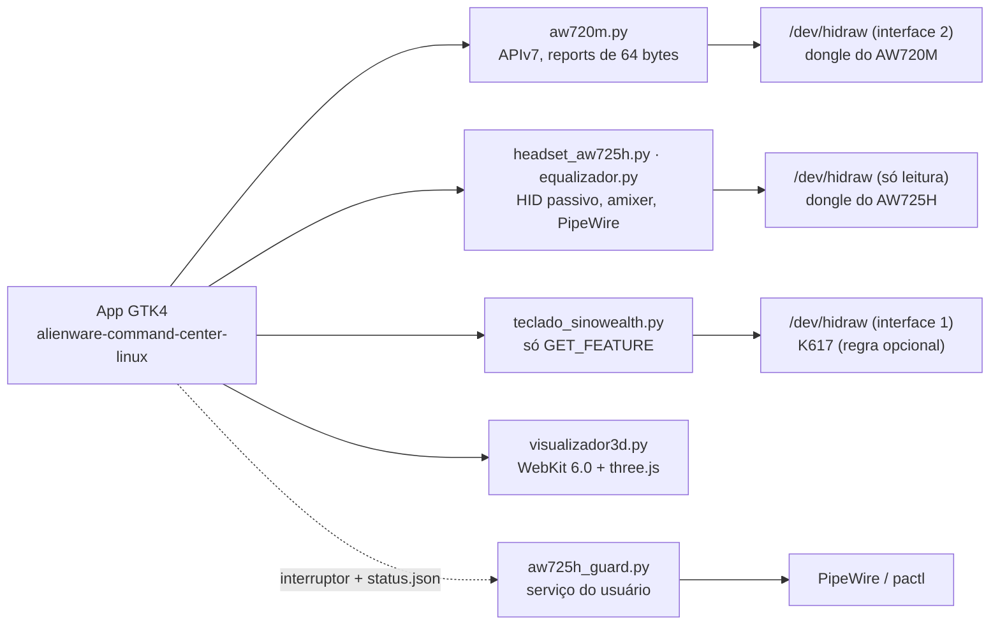

| Aparelho | Com o que o app conversa | Documento |
|---|---|---|
| AW720M | Interface 2 de fabricante do dongle (`0xFF00`, reports de 64 bytes sem report ID). Comandos do protocolo **APIv7** (alienfx-tools): luz `40 10 0c 00 EF BR ZN R G B R2 G2 B2`, status `40 03 01 00 01`; resposta `40 <cmd> 03 00 ec ac` = OK. Aviso de energia `c0 0a 09 00 01 <bateria> <carregador> …` enviado pelo mouse. | [docs/aw720m-mouse-hid-protocol.md](docs/aw720m-mouse-hid-protocol.md) |
| AW725H | sysfs (firmware), `journalctl -k` (reinícios), `pactl`/`wpctl` (PipeWire), `amixer -c Dongle` (mixer), filter-chain do PipeWire (EQ) e um leitor HID **só de leitura**: report 8 `08 c0 09 03 00 <subtipo> <valor> <xor>` (subtipo 02 = bateria %). Nada é escrito no canal HID do dongle. | [docs/aw725h-headset-linux.md](docs/aw725h-headset-linux.md) |
| K617 Fizz Rainbow | Feature reports da interface 1: 5 (5 B), 9 (504 B), 10 (41 B), 11 (126 B), 12 (1920 B), lidos com GET_FEATURE. Descritores idênticos aos da família DK200 (Sinowealth BYK901 / SH68F90A). A escrita está bloqueada no código. | [docs/sinowealth-258a-002a-keyboard-protocol.md](docs/sinowealth-258a-002a-keyboard-protocol.md) |
| Protocolos desconhecidos | Plano de captura do AWCC / do software do teclado no Windows com Wireshark + USBPcap, e leitura do `.pcapng` com `tools/ler_pcap_usbpcap.py`. | [docs/usbpcap-capture-plan-pt.md](docs/usbpcap-capture-plan-pt.md) |

O visualizador 3D é um `WebKit.WebView` que carrega `assets/3d/visualizador.html` do disco (sem internet): o three.js 0.186.1 vem junto em `assets/vendor/three/` (MIT), os controles de órbita e o bloom são próprios, e os três modelos são procedurais (não havia modelo livre para baixar destes aparelhos). O Python chama `window.aw3d.*`; os cliques nas zonas de luz voltam como mensagens. Sem WebKit ou WebGL, a página mostra o desenho SVG.

#### Estrutura do repositório

```
alienware_toolkit_linux/
├── README.md                         este arquivo
├── install.sh                        instalador (venv, udev, protetor, desktop): rode sem sudo
├── requirements.txt                  extras do pip para as ferramentas (o app usa o GTK do sistema)
├── alienware-command-center-linux/   o app GTK4
│   ├── app.py, run.sh, estilo.css, demo.py
│   ├── aw720m.py                     protocolo do AW720M (APIv7)
│   ├── headset_aw725h.py             leitor HID passivo, mixer e retorno do microfone do AW725H
│   ├── equalizador.py                EQ do AW725H no PipeWire
│   ├── teclado_sinowealth.py         módulo só de leitura do K617 / 258a:002a (escrita bloqueada)
│   ├── k617_atalhos.py               tabela de atalhos Fn
│   ├── aparencia.py                  cor dos aparelhos (~/.config/alienware-toolkit/aparencia.json)
│   ├── dispositivos.py               lista USB, reinícios, serviço do protetor, PipeWire
│   ├── ui/                           páginas, widgets, visualizador 3D, abas extras do headset
│   └── assets/                       logo, SVGs, página e modelos 3D, three.js
├── aw725h-headset-disconnect-fix/    conserto independente do ciclo de reinício do dongle do AW725H
├── tools/                            sondas de linha de comando (sondar.py, sondar_teclado.py, …)
├── udev/                             70-alienware-toolkit.rules, 71-…-optional.rules, instalador
├── desktop/                          ícones, .desktop, extensão do GNOME Shell, install-desktop.sh
└── docs/                             notas de protocolo, caderno de desenvolvimento, media/
```

### Conserto das quedas do headset AW725H

**Sintoma:** o headset sem fio Alienware AW725H cai a cada ~2,5 minutos no Linux enquanto toca áudio; o log do kernel mostra um aparelho `0e8d:0003` aparecendo por um segundo (o chip MediaTek do dongle reiniciando).

**Causa:** com o **firmware 1.00 do dongle**, ele (`413c:ab2b`) reinicia uns **140–150 s depois que o stream de áudio começa** (não depois da conexão USB). Nos nossos registros: 288 reinícios num dia, 286 com áudio tocando.

**Contorno (este repositório):** o protetor `aw725h_guard.py` roda como o serviço do usuário `alienware-headset-guard.service`. Depois de **110 s** de áudio contínuo, ele fecha e reabre de verdade o PCM do headset: move os streams para um null-sink, suspende o sink do headset por 0,3 s e devolve (corte de ~0,5 s), e o temporizador do dongle nunca chega ao limite. Uma pausa curta sem fechar o PCM (16 ms) foi testada e deixou o som de um lado só, por isso o PCM é fechado de verdade. Arquivo de estado: `~/.local/state/aw725h-guard/status.json`.

**Correção definitiva:** atualizar, no Windows, para **firmware 1.8.0 do headset + 1.1.0 do dongle** (Dell, julho de 2025, DSA-2025-303); o atualizador grava sempre os dois juntos. Depois, confira com o protetor desligado: 0 reinícios em 30 min de áudio (`tools/monitor_headset.sh 30`).

Para instalar só o conserto: `./install.sh --headset-fix`, ou veja o guia completo em [`aw725h-headset-disconnect-fix/`](aw725h-headset-disconnect-fix/) (ele funciona também sem o app).

### Teclado: Redragon K617 Fizz Rainbow

O teclado testado aqui é um **Redragon K617 Fizz Rainbow, modelo K617-R-B**: 60%, 61 teclas, ANSI (US), corpo preto, ID USB `258a:002a` (aparece como SINO WEALTH "Gaming KB").

- **As cores são fixas de fábrica.** Na versão Rainbow ("-R") cada fileira tem a sua cor de LED (vermelho, laranja, verde, azul, roxo). As teclas Fn só trocam o modo (<kbd>Fn</kbd>+<kbd>Alt direito</kbd>), o brilho (<kbd>Fn</kbd>+<kbd>M</kbd>, 5 níveis) e a velocidade (<kbd>Fn</kbd>+<kbd>,</kbd>, 5 níveis). O Linux não muda a cor, e este app não promete isso.
- **O K617 RGB é outro aparelho.** O K617 Fizz **RGB** usa `258a:0049` e já tem controle de terceiros no Linux: o [fizz-rgb](https://github.com/MrSchrodingers/fizz-rgb), de MrSchrodingers (MIT, `fizzctl` no PyPI). Ele não serve para o Rainbow `258a:002a`, que tem outro descritor (report 9 de 504 bytes, report 12 de 1920 bytes).
- **Não há protocolo de escrita confiável.** O mesmo PID é usado por várias marcas com firmwares diferentes; o OpenRGB desativou os teclados Sinowealth genéricos depois que o código dele bricou teclados Redragon; e o **report 5 também é o canal do bootloader (ISP)**. O módulo recusa qualquer escrita.
- **O que falta para ter controle de verdade (modo/brilho/velocidade pelo Linux):** uma captura USB do software oficial da Redragon no Windows (Wireshark + USBPcap), mudando uma coisa por vez. Plano em [docs/sinowealth-258a-002a-keyboard-protocol.md](docs/sinowealth-258a-002a-keyboard-protocol.md). **Contribuições são bem-vindas**, principalmente capturas, ou leituras comparadas feitas com *LER E COMPARAR* enquanto você aperta as teclas Fn.

Atalhos Fn (do manual do K617 Fizz RGB; alguns podem não existir no Rainbow):

| Teclas | Função | No Rainbow |
|---|---|---|
| <kbd>Fn</kbd>+<kbd>Alt direito</kbd> | Próximo modo de luz | sim |
| <kbd>Fn</kbd>+<kbd>M</kbd> | Brilho, 5 níveis | sim |
| <kbd>Fn</kbd>+<kbd>,</kbd> | Velocidade do efeito, 5 níveis | sim |
| <kbd>Fn</kbd>+<kbd>Espaço</kbd> | Modo de escolher cor (só no RGB: se nada piscar, o seu é o Rainbow) | não |
| <kbd>Fn</kbd>+<kbd>Win</kbd> | Trava / destrava a tecla Windows | sim |
| <kbd>Fn</kbd>+<kbd>Esc</kbd> (segurar 3 s) | Volta à configuração de fábrica (luz, trava do Windows) | talvez |
| <kbd>Fn</kbd>+<kbd>1</kbd> … <kbd>0</kbd>, <kbd>-</kbd>, <kbd>=</kbd> | F1 … F12 | sim |
| <kbd>Fn</kbd>+<kbd>W</kbd> <kbd>A</kbd> <kbd>S</kbd> <kbd>D</kbd> | Setas | sim |
| <kbd>Fn</kbd>+<kbd>[</kbd> / <kbd>]</kbd> | Insert / Delete | talvez |
| <kbd>Fn</kbd>+<kbd>;</kbd> / <kbd>'</kbd> | Home / End | talvez |
| <kbd>Fn</kbd>+<kbd>.</kbd> / <kbd>/</kbd> | Page Up / Page Down | talvez |

### Segurança e permissões

- **udev, não root.** No Ubuntu, `/dev/hidraw*` é `root 0600`. A regra `udev/70-alienware-toolkit.rules` põe `TAG+="uaccess"` só no AW720M (`413c:3028`, `413c:3029`) e no dongle do AW725H (`413c:ab2b`), para o usuário logado poder abri-los. O número 70 importa: o `uaccess` precisa ser marcado antes do `73-seat-late.rules`.
- **O teclado fica fora da regra principal de propósito.** A interface 0 do K617 é o teclado de boot e **nunca** é liberada. A interface 1 tem os feature reports da luz, **mas também carrega as teclas digitadas (NKRO, report 6)**: com acesso a ela, qualquer programa da sua sessão poderia ler o que você digita. Por isso a `udev/71-sinowealth-keyboard-optional.rules` é opcional (`./install.sh --keyboard-experimental`, com confirmação) e só serve para as ferramentas de leitura. O app só usa feature reports e nunca lê as teclas. Remova a regra quando terminar: `sudo rm /etc/udev/rules.d/71-sinowealth-keyboard-optional.rules && sudo udevadm control --reload-rules`.
- **O report 5 do teclado é o canal do bootloader**: escrever `05 75 …` reiniciaria o teclado no modo de gravação de firmware. O `teclado_sinowealth.py` bloqueia qualquer escrita nele, e toda escrita no teclado está desligada.
- **Nada é enviado sem um clique.** O mouse só recebe comando no **✓ APLICAR** (ou no botão de diagnóstico *Ler status*). As prévias (cores, efeitos, modos Fn, luz do headset) só mexem no modelo 3D. O canal HID do headset é aberto só para leitura.
- **Os modos de demonstração e de captura não enviam nada** e não gravam configurações: só mexem nos controles de prévia.
- **Só entram comandos vistos funcionando.** Nada de varrer comandos no escuro (poderia mudar configurações salvas no aparelho). Nada de gravar firmware.
- O instalador se recusa a rodar como root; ele chama o `sudo` sozinho só para copiar a regra udev (e a regra opcional do ModemManager do conserto do headset).

### Problemas comuns e perguntas frequentes

<details>
<summary><b>Som de um lado só (AW725H)</b></summary>

Com o firmware 1.00, o dongle às vezes volta tocando em **um lado só** depois que o stream de áudio reabre. O Linux manda os dois canais iguais; o problema é do dongle.

- No app: **Headset → Estado → "Som de um lado só?"**: clique em **TESTAR CANAIS (E/D)** (você deve ouvir "Front Left" à esquerda e "Front Right" à direita) e depois em **REPARAR SOM AGORA**, que reabre o stream com uma pausa de 1 s, como numa reconexão.
- Pelo terminal:
  ```bash
  python3 aw725h-headset-disconnect-fix/aw725h_guard.py --channel-test   # teste de voz esquerda/direita
  python3 aw725h-headset-disconnect-fix/aw725h_guard.py --reopen 1.0     # reabre o stream (pausa de 1 s)
  ```
- Se não resolver, clique de novo ou desligue e ligue o headset.
</details>

<details>
<summary><b>Por que o headset mostra um valor de bateria só?</b></summary>

O AW725H tem **uma bateria interna** que alimenta as duas conchas, então não existe bateria por lado. O valor vem de um aviso que o dongle manda sozinho quando o nível muda (report 8, `c0 09`, subtipo 02), lido sem enviar nada. Até chegar o primeiro aviso, o app mostra "não informado pelo dongle". Parece ser uma estimativa e anda rápido perto do fim.
</details>

<details>
<summary><b>A página do mouse diz "sem permissão"</b></summary>

Falta a regra udev, ou o aparelho foi ligado antes de ela ser instalada. Rode o `./install.sh` de novo (ou clique em *Dar permissão*) e depois tire e ponha o dongle. Confira com `getfacl /dev/hidrawN` (o seu usuário precisa aparecer).
</details>

<details>
<summary><b>O modelo 3D não aparece (vejo um desenho)</b></summary>

Instale o `gir1.2-webkit-6.0`. Sem o WebKit 6.0, ou se o WebGL falhar, a página usa o desenho SVG e escreve o motivo no terminal (`./alienware-command-center-linux/run.sh`). `AW3D_DEPURAR=1` liga o inspetor do WebKit.
</details>

<details>
<summary><b>A bateria do mouse mostra "—" ou um valor antigo</b></summary>

O AW720M não responde a pedidos de bateria (até onde se sabe); ele só manda o aviso de energia ao encostar ou tirar o carregador magnético. Encoste/tire uma vez. O último valor fica em `logs/bateria.json`.
</details>

<details>
<summary><b>O ícone da dock não anima</b></summary>

No Wayland, saia e entre na sessão uma vez depois de instalar. Depois confira `gnome-extensions info alienware-toolkit-hover@jmetrimiranda.github.io` (State: ACTIVE) e, se preciso, ligue as extensões de usuário no app *Extensões*.
</details>

<details>
<summary><b>"Nenhum Bluetooth encontrado" / dá para usar o mouse pelo Bluetooth?</b></summary>

O AW720M também tem Bluetooth, mas este app fala com ele pelo dongle 2.4 GHz (ou pelo cabo USB-C). Pelo Bluetooth só viria o serviço padrão de bateria, não a luz. No PC de teste a placa de Wi-Fi (MT7921U) nem tem interface Bluetooth.
</details>

<details>
<summary><b>O mouse desliga quando ligo o cabo USB-C nele (413c:3028)</b></summary>

O `97-hid2hci.rules` do bluez pode desligá-lo (bluez issue #2680). Copie `/usr/lib/udev/rules.d/97-hid2hci.rules` para `/etc/udev/rules.d/` e acrescente `ATTRS{product}!="*AW720M*"` na linha da Dell.
</details>

<details>
<summary><b>Isto substitui o Alienware Command Center?</b></summary>

Não, só nas partes listadas em [Recursos](#recursos). Atualização de firmware, DPI, macros e a luz do headset continuam precisando do AWCC no Windows.
</details>

### Roteiro

- [ ] Interface em inglês (hoje o código e os textos estão em português).
- [ ] AW720M: bateria sob demanda, DPI, taxa de polling e distância de levantamento (precisa de captura USBPcap do AWCC).
- [ ] AW725H: controle de verdade da luz das cabeças de alien (precisa de captura); decifrar o segundo aviso HID (subtipo 01).
- [ ] K617 Fizz Rainbow: modo/brilho/velocidade pelo Linux, se um protocolo seguro for capturado.
- [ ] Publicar as baterias no UPower, para aparecerem no menu de energia do GNOME.
- [ ] Aviso de bateria fraca.
- [ ] Empacotamento (Flatpak ou .deb).

### Desenvolvimento

- **Rodar do código:** `./alienware-command-center-linux/run.sh` (usa o `../.venv` se existir; senão, o `python3`).
- **Modo de captura** (sem tela, com o broadway):
  ```bash
  ALIENWARE_CAPTURA=/tmp/saida.png ALIENWARE_PAGINA=mouse:bateria ./alienware-command-center-linux/run.sh
  ```
  `ALIENWARE_PAGINA` = `inicio`, `mouse[:iluminacao|bateria|diagnostico]`, `headset[:estado|estabilidade|protecao|audio|microfone|equalizador|iluminacao|bateria]`, `teclado[:iluminacao|atalhos|informacoes]`, `config`, `sobre` ou `outro`. `ALIENWARE_ESPERA` = segundos até a captura (padrão 2,5). `ALIENWARE_SEM_3D=1` força os desenhos SVG (automático com `GDK_BACKEND=broadway`).
- **Modo de demonstração** (usado nos GIFs e vídeos deste README; precisa de tela de verdade por causa do WebGL):
  ```bash
  ALIENWARE_DEMO=tour  ALIENWARE_DEMO_PASTA=/tmp/demo  ./alienware-command-center-linux/run.sh   # quadros JPEG + legendas em quadros.jsonl
  ALIENWARE_DEMO=fotos ALIENWARE_DEMO_PASTA=/tmp/fotos ./alienware-command-center-linux/run.sh   # um PNG por página e aba
  ```
  Ele navega sozinho, grava os quadros no `after-paint` do relógio de quadros (`ALIENWARE_DEMO_FPS`, padrão 10) e fecha (`ALIENWARE_DEMO_LIMITE`, padrão 62 s). Só mexe nos controles de prévia.
- **Ferramentas** (`tools/`, todas só de leitura, salvo onde indicado):

  | Ferramenta | Para quê |
  |---|---|
  | `sondar.py escutar 60` / `extras 20` / `gravar 90` / `guiado` | Escutar o AW720M (seguro); os logs vão para o `logs/` do app. `status` e `cor` são experimentais e enviam comandos. |
  | `teste_guiado.sh` | Abre o teste guiado do mouse num terminal. |
  | `monitor_headset.sh 30` | Conta os reinícios do dongle do AW725H nos últimos N minutos. |
  | `sondar_teclado.py info` / `ler` / `backup` / `comparar A B` | Feature reports do K617 / `258a:002a` (só GET_FEATURE). |
  | `escuta_passiva.py`, `analisar_escuta.py` | Escuta passiva longa do dongle do AW725H e decodificação do log. |
  | `ler_pcap_usbpcap.py captura.pcapng` | Lista as transferências de controle HID de uma captura USBPcap do Windows. |
- **Notas:** o caderno de desenvolvimento está em [docs/development-notes-pt.md](docs/development-notes-pt.md).

### Créditos

- **[alienfx-tools](https://github.com/T-Troll/alienfx-tools), de T-Troll**: o protocolo APIv7 usado na luz do AW720M (feito originalmente para o AW610M).
- **[three.js](https://threejs.org/)** (MIT): renderização 3D, incluída em `alienware-command-center-linux/assets/vendor/three/` com a licença.
- **Modelos 3D:** procedurais, feitos para este projeto (não foi encontrado modelo livre destes aparelhos para baixar). Notas da busca em [docs/3d-models-credits-pt.md](docs/3d-models-credits-pt.md).
- **[fizz-rgb](https://github.com/MrSchrodingers/fizz-rgb), de MrSchrodingers** (MIT): referência para quem tem o K617 Fizz RGB (`258a:0049`).
- **OpenRGB**, issue [#1804](https://gitlab.com/CalcProgrammer1/OpenRGB/-/issues/1804): identificação da família Sinowealth DK200 / BYK901 e dos descritores.
- Logo, ícone e animação da dock: desenhos originais deste projeto.

### Licença

Distribuído sob a [licença MIT](LICENSE) © 2026 Jorge Metri Miranda. Você pode usar, modificar e redistribuir, inclusive em outros projetos (OpenRGB, libratbag etc.), desde que mantenha o aviso de copyright. O three.js incluído mantém a própria licença MIT.

### Aviso

Projeto independente, da comunidade. **Não tem vínculo, aval nem patrocínio da Dell, da Alienware nem da Redragon.** Alienware, AlienFX, Alienware Command Center, Dark Side of the Moon e Lunar Light são marcas da Dell Inc.; Redragon e K617 Fizz pertencem aos seus donos. O logo e os ícones são desenhos originais inspirados na marca. Use por sua conta e risco: o app só envia comandos vistos funcionando, mas vem sem garantia.

---

<sub>Keywords / palavras-chave: alienware linux, alienware command center linux, awcc linux alternative, alienfx linux, alienware aw720m linux, aw720m rgb linux, aw720m battery linux, alienware mouse rgb ubuntu, alienware wireless mouse linux, alienware aw725h linux, aw725h disconnecting linux, aw725h dongle reboot, aw725h headset fix ubuntu, alienware headset linux pipewire, alienware headset equalizer linux, alienware headset battery linux, redragon k617 linux, redragon k617 fizz rainbow linux, k617 fn shortcuts, sinowealth 258a:002a, 413c:3029, 413c:ab2b, gtk4 libadwaita peripheral control panel, three.js 3d device viewer, ubuntu 24.04 gnome 46 rgb, mouse alienware no linux, headset alienware caindo no linux, controle de rgb no ubuntu, teclado redragon k617 no linux</sub>
