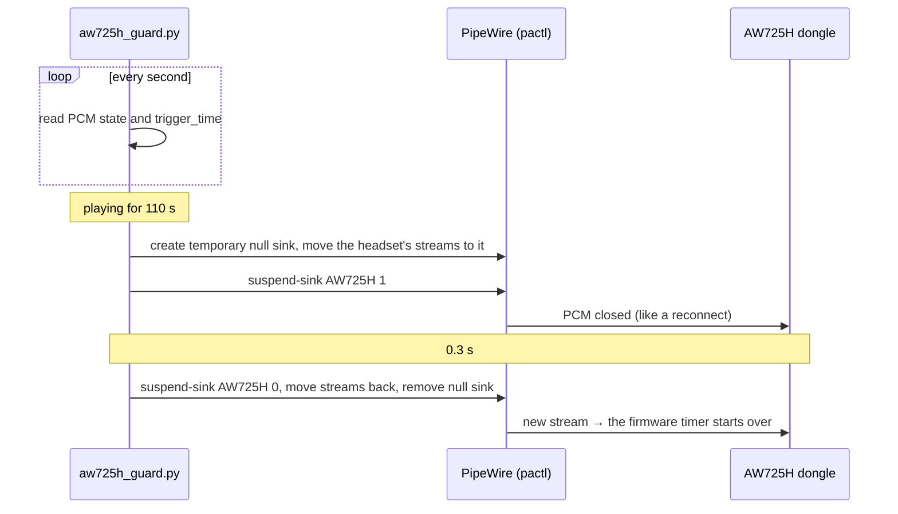

# Alienware AW725H headset keeps disconnecting on Linux: fix for the USB dongle reboot loop (every ~2.5 min)


-00c8d7)


> **TL;DR** — With dongle firmware **1.00**, the Alienware AW725H 2.4 GHz dongle **reboots itself ~140–150 s after audio starts playing**.
> The timer restarts whenever the audio stream is closed and reopened. This repo ships a tiny user service that reopens the stream every 110 s
> (a ~0.5 s gap instead of a 3–5 s disconnect). Measured: **~24 reboots per hour of audio → 0**. The permanent fix is the Dell firmware update (headset 1.8.0 + dongle 1.1.0).

> Part of **[Alienware Toolkit for Linux](../README.md)**: this folder works on its own (Python standard library + `pactl`), and the toolkit app ([`alienware-command-center-linux/`](../alienware-command-center-linux/)) shows its state, toggles it and has one-click buttons for the [one-side-only problem](#9-sound-on-one-side-only).
> Parte do **Alienware Toolkit for Linux**: esta pasta funciona sozinha, e o app do toolkit mostra o estado, liga/desliga o protetor e tem os botões para o [som de um lado só](#9-som-de-um-lado-só).

**[English](#english)** · **[Português](#portugues)**

---

<a id="english"></a>
## 🇺🇸 English

### 1. Is this your problem?

You probably have exactly this bug if **all** of these are true:

- [ ] You use the **Alienware Tri-Mode Wireless Gaming Headset AW725H** through its **USB-C 2.4 GHz dongle** on Linux.
- [ ] While something is **playing**, the sound **cuts out every ~2.5 minutes**: the headset disappears from the sound settings for 3–5 s and apps jump to the speakers/HDMI, then come back.
- [ ] With **nothing playing**, the dongle stays connected for hours.
- [ ] `lsusb` shows `413c:ab2b Dell Computer Corp. AW725H Dongle`.

Look at the kernel log (`journalctl -k -f` or `sudo dmesg -w`) while audio plays. Every ~150 s you will see this cycle:

```text
usb 1-2: USB disconnect, device number 66
usb 1-2: New USB device found, idVendor=0e8d, idProduct=0003, bcdDevice= 1.00   <- MediaTek bootloader = the dongle rebooting
cdc_acm 1-2:1.0: ttyACM0: USB ACM device
usb 1-2: USB disconnect, device number 67
usb 1-2: New USB device found, idVendor=413c, idProduct=ab2b, bcdDevice= 1.00
usbhid 1-2:1.5: can't add hid device: -71
usb 1-2: USB disconnect, device number 68
usb 1-2: New USB device found, idVendor=413c, idProduct=ab2b, bcdDevice= 1.00
```

The fastest check: keep audio playing on the headset and run

```bash
./check.sh 30
```

Real output (60-minute window, before the fix):

```text
Dongle:   413c:ab2b on port 1-2, 12 Mb/s, firmware 1.00
Audio:    playing now / tocando agora = yes
Reboots:  20 in the last 60 min / reinícios nos últimos 60 min
Interval: median 147 s between reboots / mediana entre reinícios
YES: same problem (reboot every ~2.5 min while audio plays).
```

### 2. What is going on

The dongle's firmware (1.00) restarts its MediaTek chip a fixed time after a **playback stream starts**. We proved it by restarting the stream in the middle of a cycle:

| Measurement (29 Oct 2026) | Result |
|---|---|
| Reboots in ~24 h, before the fix | **288**, of which **286** happened while audio was playing |
| Interval between reboots | median **147 s** (145–155 s in 9 out of 10 cycles) |
| Nothing playing (overnight) | **0** reboots in 9 h |
| Stream restarted 80 s after a reconnect | the reboot expected 150 s after the **connection** did **not** happen. It came **141 s after the stream restart** → the timer follows the **stream** |
| With the guard running | **0** reboots in 12 min of continuous audio (7 interventions, one every ~111 s); ~5 were expected without it |

What it is **not**: USB autosuspend (it was already off), a bad port (it happens on rear ports wired straight to the motherboard), PipeWire volume or balance, or PipeWire buffer sizes.

### 3. How the fix works

`aw725h_guard.py` runs as a **systemd user service**. It needs no root and sends nothing to the USB device. Every second it reads how long the headset's ALSA PCM has been playing (`/proc/asound/cardN/pcm0p/sub0/status`). When playback reaches **110 s** (safely below the ~140 s limit), it **really closes and reopens** the stream:



You hear a **~0.5 s gap** every ~110 s of continuous playback, instead of a 3–5 s disconnect with apps jumping between outputs. When nothing is playing, the guard does nothing.

> ⚠️ **Do not "simplify" this to `pactl suspend-sink 1 && pactl suspend-sink 0` while audio plays.** With an active stream that only stops and starts the PCM for ~16 ms, without closing it. It does reset the timer, but the dongle may then play on **one side only** (we hit that; see [section 9](#9-sound-on-one-side-only)). The null-sink move is what makes the PCM close for real.

### 4. Install

Requirements: PipeWire with `pipewire-pulse` (the `pactl` command), a systemd user session and Python 3.8+ (standard library only).

```bash
git clone https://github.com/jmetrimiranda/alienware_toolkit_linux.git
cd alienware_toolkit_linux/aw725h-headset-disconnect-fix
./check.sh 30          # confirm it is the same problem (keep audio playing)
./install.sh           # installs and starts alienware-headset-guard.service (no root)
./install.sh --udev    # optional: also makes ModemManager ignore the rebooting dongle (asks for sudo by itself)
```

Run it as your normal user, **without `sudo` in front** (it refuses to run as root; `--udev` asks for the
password only to copy the rule). From the repository root, `./install.sh --headset-fix` calls this same
installer. The service runs the script **from this folder** (`ExecStart=/usr/bin/python3 "<folder>/aw725h_guard.py"`),
so keep the folder where it is, or run `./install.sh` again after moving it.

### 5. Verify

```bash
journalctl --user -u alienware-headset-guard -f     # "Stream reopened after 111 s (1 stream(s) moved)"
cat ~/.local/state/aw725h-guard/status.json          # interventions, last_intervention, resets_detected
./check.sh 30                                        # after 30 min of audio: "OK: no reboots while playing"
```

The toolkit app reads the same `status.json` in the headset page, tab **Proteção** (where the switch
runs `systemctl --user enable --now` / `disable --now`), and counts the dongle reboots per hour in the tab **Estabilidade**.

Counting reboots needs read access to the kernel log (group `adm` or `systemd-journal`, the default for the first user on Ubuntu). Without it, `resets_detected` is `null`.

### 6. Configuration (`config.json`, optional)

| Key | Default | Meaning |
|---|---|---|
| `interval_s` | `110` | Reopen the stream after this many seconds of continuous playback. Keep it below ~140. |
| `pause_s` | `0.3` | How long the PCM stays closed. |
| `usb_id` | `413c:ab2b` | USB ID of the dongle (matched against `/proc/asound/card*/usbid`). |
| `sink_match` | `AW725H` | Piece of the PipeWire sink name. |

Run `systemctl --user restart alienware-headset-guard` after editing.

### 7. Uninstall

```bash
./install.sh --uninstall
sudo rm -f /etc/udev/rules.d/71-aw725h-modemmanager.rules   # only if you used --udev
```

### 8. Permanent fix: update the firmware (Windows only)

Dell released **headset 1.8.0 + dongle 1.1.0** (July 2025, which also fixes security advisory DSA-2025-303). The updater only runs on Windows.

1. On a Windows PC, download "AW725H Headset firmware version 1.8.0, Dongle version 1.1.0":
   <https://www.dell.com/support/home/en-us/drivers/driversdetails?driverid=3gcwv>
2. Connect the **headset with the USB-C cable** and plug the **dongle** in.
3. Update **both** the headset and the dongle. Dell warns that updating only one breaks the pairing. Do not unplug anything during the update.
4. Back on Linux, `./check.sh` should show a firmware other than `1.00`. Stop the guard (`systemctl --user stop alienware-headset-guard`), play audio for 30 min and run `./check.sh 30`. If you get 0 reboots, uninstall the guard.

### 9. Sound on one side only

**Symptom:** after the audio stream is reopened (by the guard, by a pause, by an app that reopens its output) the
headset sometimes keeps playing on **one ear only**.

**Cause:** dongle firmware 1.00. Linux sends both channels with the same level; the dongle itself sometimes comes back
from a stream restart with one channel dead. It happened every time with a 16 ms pause (see the warning in section 3)
and, rarely, after a normal intervention of the guard.

**Fix (one click, nothing is sent to the USB device):** reopen the stream with a longer pause, like a reconnect.

```bash
python3 aw725h_guard.py --channel-test   # says "Front Left" and "Front Right", one on each ear
python3 aw725h_guard.py --reopen 1.0     # closes the headset PCM for 1 s and moves the streams back
```

In the toolkit app: headset page → tab **Estado** → section **"Som de um lado só?"** → buttons **TESTAR CANAIS (E/D)**
and **REPARAR SOM AGORA** (they run exactly these two commands). If one side is still silent, click again, or switch
the headset off and on. The firmware update (section 8) is the definitive fix.

### 10. FAQ

- **Will I notice the gap?** A short blip (~0.5 s) every ~110 s, and only while something plays continuously. It is far less annoying than the disconnect.
- **Does it affect the microphone?** No. Only the playback sink is reopened.
- **Sound on one ear only?** See [section 9](#9-sound-on-one-side-only): `python3 aw725h_guard.py --reopen 1.0`.
- **Do apps get stuck on the headset?** No. Streams go back to the same sink, and PipeWire keeps them set to "follow default".
- **Is it safe for the device?** Yes. It only opens and closes an audio stream, exactly like pausing music. No HID or USB commands, no resets, no root.
- **Other Alienware/Dell dongles (AW720H, AW920H…)?** Run `check.sh` with your IDs (`usb_id`, `sink_match` in `config.json`). If you see the same "bootloader every ~150 s while playing" pattern, the same trick should work.

### 11. Tested on

| Item | Version |
|---|---|
| OS | Ubuntu 24.04.5 LTS, GNOME 46 (Wayland) |
| Kernel | 7.0.0-38-generic (`snd-usb-audio`) |
| Audio | PipeWire 1.0.5, WirePlumber 0.4.17, pactl 16.1 |
| Dongle | AW725H Dongle 413c:ab2b, firmware 1.00, full speed (12 Mb/s) |

<sub>**Search keywords:** Alienware AW725H Linux, AW725H disconnecting, AW725H keeps disconnecting Ubuntu, Alienware Tri-Mode Wireless Gaming Headset Linux, AW725H dongle reboot, 413c:ab2b, 0e8d:0003 MediaTek bootloader, headset audio cuts out every 2 minutes Linux, USB headset disconnects every 150 seconds, PipeWire USB headset reconnect loop, snd-usb-audio disconnect, Dell headset Linux fix.</sub>

---

<a id="portugues"></a>
## 🇧🇷 Português

### 1. É o seu problema?

Você provavelmente tem exatamente este defeito se **tudo** abaixo for verdade:

- [ ] Usa o **Alienware Tri-Mode Wireless Gaming Headset AW725H** pelo **dongle USB-C 2.4 GHz** no Linux.
- [ ] Enquanto algo está **tocando**, o som **corta a cada ~2,5 minutos**: o headset some das configurações de som por 3–5 s e os apps pulam para as caixas de som/HDMI, depois voltam.
- [ ] **Sem nada tocando**, o dongle fica conectado por horas.
- [ ] O `lsusb` mostra `413c:ab2b Dell Computer Corp. AW725H Dongle`.

Com áudio tocando, olhe o log do kernel (`journalctl -k -f` ou `sudo dmesg -w`). A cada ~150 s aparece o ciclo mostrado na [seção em inglês](#1-is-this-your-problem): `USB disconnect` → `idVendor=0e8d, idProduct=0003` (o bootloader MediaTek, ou seja, o dongle reiniciando) → `ttyACM0` → `413c:ab2b` com `can't add hid device: -71` → reconexão.

Teste rápido: deixe algum áudio tocando no headset e rode

```bash
./check.sh 30
```

Se aparecer `SIM: é o mesmo problema`, este conserto é para você.

### 2. O que está acontecendo

O firmware do dongle (1.00) reinicia o chip MediaTek um tempo fixo depois que **um stream de reprodução começa**. Provamos isso reiniciando o stream no meio de um ciclo:

| Medição (29/10/2026) | Resultado |
|---|---|
| Reinícios em ~24 h, antes do conserto | **288**, sendo **286** com áudio tocando |
| Intervalo entre reinícios | mediana de **147 s** (145–155 s em 9 de cada 10 ciclos) |
| Sem áudio (de madrugada) | **0** reinícios em 9 h |
| Stream reiniciado 80 s depois de uma reconexão | o reinício esperado 150 s depois da **conexão** **não** veio. Veio **141 s depois do reinício do stream**, ou seja, o temporizador segue o **stream** |
| Com o protetor rodando | **0** reinícios em 12 min de áudio contínuo (7 intervenções, uma a cada ~111 s); sem ele seriam ~5 |

O que **não** é: autosuspend do USB (já estava desligado), porta ruim (acontece em portas traseiras ligadas direto na placa-mãe), volume ou balanço do PipeWire, nem tamanho de buffer.

### 3. Como o conserto funciona

O `aw725h_guard.py` roda como **serviço de usuário do systemd**. Não precisa de root e não envia nada ao aparelho USB. A cada segundo, ele lê há quanto tempo o PCM ALSA do headset está tocando (`/proc/asound/cardN/pcm0p/sub0/status`). Quando chega a **110 s** (com folga antes do limite de ~140 s), ele **fecha e reabre de verdade** o stream:

1. cria uma saída muda temporária (null sink) e move para ela os streams do headset;
2. suspende o sink do headset (o PCM fecha, como numa reconexão);
3. espera 0,3 s, reabre o sink, devolve os streams e apaga a saída muda.

O diagrama da [seção em inglês](#3-how-the-fix-works) mostra a sequência. Você ouve um **corte de ~0,5 s** a cada ~110 s de áudio contínuo, em vez de uma queda de 3–5 s com os apps pulando de saída. Sem áudio, o protetor não faz nada.

> ⚠️ **Não "simplifique" para `pactl suspend-sink 1 && pactl suspend-sink 0` com áudio tocando.** Com um stream ativo, isso só para e reinicia o PCM por ~16 ms, sem fechá-lo. O temporizador zera, mas o dongle pode passar a tocar **só de um lado** (aconteceu nos testes; veja a [seção 9](#9-som-de-um-lado-só)). É a troca para a saída muda que faz o PCM fechar de verdade.

### 4. Instalação

Requisitos: PipeWire com `pipewire-pulse` (comando `pactl`), sessão de usuário do systemd e Python 3.8+ (só biblioteca padrão).

```bash
git clone https://github.com/jmetrimiranda/alienware_toolkit_linux.git
cd alienware_toolkit_linux/aw725h-headset-disconnect-fix
./check.sh 30          # confirma que é o mesmo problema (com áudio tocando)
./install.sh           # instala e liga o alienware-headset-guard.service (sem root)
./install.sh --udev    # opcional: faz o ModemManager ignorar o dongle reiniciando (pede sudo sozinho)
```

Rode como seu usuário, **sem `sudo` na frente** (ele se recusa a rodar como root; o `--udev` pede a senha só para copiar
a regra). Da raiz do repositório, `./install.sh --headset-fix` chama este mesmo instalador. O serviço roda o script **a
partir desta pasta**. Não mova a pasta, ou rode `./install.sh` de novo depois de mover.

### 5. Como conferir

```bash
journalctl --user -u alienware-headset-guard -f     # "Stream reopened after 111 s (1 stream(s) moved)"
cat ~/.local/state/aw725h-guard/status.json          # intervenções, última intervenção, reinícios detectados
./check.sh 30                                        # depois de 30 min de áudio: "OK: nenhum reinício com áudio tocando"
```

O app do toolkit lê o mesmo `status.json` na página do headset, aba **Proteção** (o interruptor de lá roda
`systemctl --user enable --now` / `disable --now`), e conta os reinícios do dongle por hora na aba **Estabilidade**.

Para contar os reinícios, o usuário precisa ler o log do kernel (grupo `adm` ou `systemd-journal`, padrão para o primeiro usuário do Ubuntu). Sem isso, `resets_detected` fica `null`.

### 6. Configuração (`config.json`, opcional)

| Chave | Padrão | Significado |
|---|---|---|
| `interval_s` | `110` | Reabre o stream depois de tantos segundos de áudio contínuo. Mantenha abaixo de ~140. |
| `pause_s` | `0.3` | Quanto tempo o PCM fica fechado. |
| `usb_id` | `413c:ab2b` | ID USB do dongle (comparado com `/proc/asound/card*/usbid`). |
| `sink_match` | `AW725H` | Pedaço do nome do sink no PipeWire. |

Depois de editar, rode `systemctl --user restart alienware-headset-guard`.

### 7. Desinstalar

```bash
./install.sh --uninstall
sudo rm -f /etc/udev/rules.d/71-aw725h-modemmanager.rules   # só se usou --udev
```

### 8. Correção definitiva: atualizar o firmware (só no Windows)

A Dell lançou **headset 1.8.0 + dongle 1.1.0** (julho de 2025, com correção de segurança DSA-2025-303). O atualizador só roda no Windows.

1. Num PC com Windows, baixe "AW725H Headset firmware version 1.8.0, Dongle version 1.1.0":
   <https://www.dell.com/support/home/en-us/drivers/driversdetails?driverid=3gcwv>
2. Ligue o **headset pelo cabo USB-C** e espete o **dongle**.
3. Atualize **os dois**: headset e dongle. A Dell avisa que atualizar só um quebra o pareamento. Não desconecte nada durante a atualização.
4. De volta ao Linux, o `./check.sh` deve mostrar um firmware diferente de `1.00`. Pare o protetor (`systemctl --user stop alienware-headset-guard`), toque áudio por 30 min e rode `./check.sh 30`. Com 0 reinícios, desinstale o protetor.

### 9. Som de um lado só

**Sintoma:** depois que o stream de áudio reabre (pelo protetor, por uma pausa, por um app que reabre a saída), o
headset às vezes continua tocando **só de um lado**.

**Causa:** firmware 1.00 do dongle. O Linux manda os dois canais iguais; é o dongle que às vezes volta de um reinício
do stream com um canal mudo. Aconteceu sempre com a pausa de 16 ms (veja o aviso da seção 3) e, raramente, depois de
uma intervenção normal do protetor.

**Conserto (um clique, nada é enviado ao aparelho USB):** reabrir o stream com uma pausa maior, como numa reconexão.

```bash
python3 aw725h_guard.py --channel-test   # fala "Front Left" e "Front Right", um em cada lado
python3 aw725h_guard.py --reopen 1.0     # fecha o PCM do headset por 1 s e devolve os streams
```

No app do toolkit: página do headset → aba **Estado** → seção **"Som de um lado só?"** → botões **TESTAR CANAIS (E/D)**
e **REPARAR SOM AGORA** (rodam exatamente esses dois comandos). Se um lado continuar mudo, clique de novo ou desligue
e ligue o headset. A atualização de firmware (seção 8) resolve de vez.

### 10. Perguntas frequentes

- **Vou perceber o corte?** Um soluço curto (~0,5 s) a cada ~110 s, só com áudio tocando sem parar. Incomoda bem menos que a queda.
- **Afeta o microfone?** Não. Só o sink de reprodução é reaberto.
- **Som só de um lado?** Veja a [seção 9](#9-som-de-um-lado-só): `python3 aw725h_guard.py --reopen 1.0`.
- **Os apps ficam presos no headset?** Não. Os streams voltam para o mesmo sink, e o PipeWire os mantém em "seguir a saída padrão".
- **É seguro para o aparelho?** Sim. Ele só abre e fecha um stream de áudio, igual a pausar uma música. Sem comandos HID ou USB, sem reset, sem root.
- **Outros dongles Alienware/Dell (AW720H, AW920H…)?** Rode o `check.sh` com os seus IDs (`usb_id` e `sink_match` no `config.json`). Se aparecer o mesmo padrão de "bootloader a cada ~150 s com áudio tocando", o mesmo truque deve funcionar.

### 11. Testado em

Ubuntu 24.04.5 LTS (GNOME 46, Wayland), kernel 7.0.0-38, PipeWire 1.0.5, WirePlumber 0.4.17, dongle AW725H 413c:ab2b com firmware 1.00 em full speed (12 Mb/s).

<sub>**Palavras-chave:** Alienware AW725H Linux, AW725H desconectando, headset Alienware cai a cada 2 minutos, AW725H Ubuntu sem som, dongle AW725H reiniciando, 413c:ab2b, 0e8d:0003, fone USB desconecta sozinho Linux, PipeWire headset reconectando, conserto headset Alienware Linux.</sub>

---

### Files / Arquivos

| File | What it does / O que faz |
|---|---|
| `aw725h_guard.py` | The guard (systemd user service); `--reopen [pause_s]` and `--channel-test` one-shot helpers / o protetor (serviço de usuário) e os atalhos `--reopen` e `--channel-test` |
| `install.sh` | Install, `--udev`, `--uninstall` (never with sudo) / instalar, `--udev`, `--uninstall` (nunca com sudo) |
| `check.sh` | "Is it my problem?" diagnosis / diagnóstico "é o meu problema?" |
| `config.json` | Optional settings / ajustes opcionais |
| `71-aw725h-modemmanager.rules` | Optional udev rule: ModemManager ignores the dongle / regra udev opcional |
| `README.md` | This guide / este guia (opened by the app's **ABRIR GUIA** button / aberto pelo botão **ABRIR GUIA** do app) |
